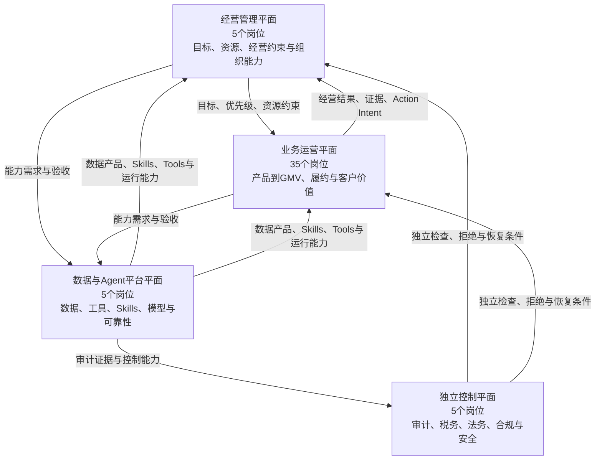

# 50个AI岗位的四平面组织责任图

状态：D-021已确认。结构化数据见[organization-graph.json](organization-graph.json)。本图表示逻辑岗位责任、利益冲突隔离和能力供给，不表示行政上下级、运行实例、Agent路由或任何数据/工具权限。

## 顶层组织

任何箭头都不代表一个Agent向另一个Agent发送自由文本或授予权限。实际工单仍由一个Case Agent拥有上下文；上图关系通过目标契约、Skills、标准产物、确定性检查和系统回执实现。

## 5个经营管理岗位

| ID | 分身 | 岗位 | 在组织中的责任 |
| --- | --- | --- | --- |
| AGT-001 | 衡远 | 经营目标与资源统筹 | 形成目标、优先级和资源取舍契约 |
| AGT-002 | 枢衡 | 场景自主编排与异常协调 | v2负责工单制度与例外协调建议；运行时路由由模型外Case Control替代 |
| AGT-003 | 明镜 | 经营分析与决策支持 | 提供带来源的经营判断和决策证据 |
| AGT-004 | 知人 | 组织能力与人事行政 | 维护能力需求和组织调整建议，不直接执行人员动作 |
| AGT-041 | 守金 | 经营财务与资金 | 给出现金、预算和资源约束；资金动作仍由模型外控制 |

## 35个业务运营岗位

| 第二视角 | 岗位 |
| --- | --- |
| 产品与创新（8） | AGT-006 听澜、007 望野、008 拓新、009 定形、010 映物、011 砺器、012 灵枢、013 求证 |
| 供应与履约（7） | AGT-014 择源、015 契约、016 知量、017 衡仓、018 质守、019 通途、020 行舟 |
| 渠道经营（8） | AGT-021 北辰、022 觅位、023 自航、024 拓域、025 联商、026 衡价、027 守店、028 译境 |
| 品牌与增长（7） | AGT-029 立言、030 叙事、031 绘影、032 点火、033 结伴、034 续缘、035 试真 |
| 服务与体验（4） | AGT-036 安心、037 解忧、038 回声、039 同行 |
| 财务运营（1） | AGT-040 清账 |

业务运营岗位直接承接产品、供应、渠道、增长、服务和GMV事实闭环。它们可以成为Case Agent的主岗位人格，也可以把专业步骤作为Skills贡献给其他场景；不会因此获得目标系统写入权。

## 5个独立控制岗位

| ID | 分身 | 岗位 | 独立性边界 |
| --- | --- | --- | --- |
| AGT-005 | 守衡 | 内控审计与独立复核 | 不负责被审对象的业务结果或配置发布 |
| AGT-042 | 合账 | 税务与跨境实体协作 | 不以GMV目标覆盖税务和实体约束 |
| AGT-043 | 律衡 | 法务与知识产权 | 不以业务紧迫性替代法律证据和外部资格 |
| AGT-044 | 安界 | 产品合规与隐私 | 不自行降低准入、宣称、隐私和数据边界 |
| AGT-050 | 门卫 | 信息安全与权限 | 提出工具、身份和Policy控制要求，但不把凭据交给模型 |

独立控制岗位可以否决、冻结或提出恢复条件，但普通LLM输出不能成为最终资产授权。最终控制由模型外Policy Gate执行。

## 5个数据与Agent平台岗位

| ID | 分身 | 岗位 | 平台责任 |
| --- | --- | --- | --- |
| AGT-045 | 同尺 | 业务口径与主数据 | 维护指标和业务对象契约 |
| AGT-046 | 清源 | 数据工程与质量 | 提供带质量状态、来源和新鲜度的数据产物 |
| AGT-047 | 接桥 | 系统集成与业务工具 | 维护Tool、MCP、API和hook能力契约 |
| AGT-048 | 积知 | 知识技能与Playbook治理 | 管理Skill、Playbook和Memory Policy候选版本 |
| AGT-049 | 稳行 | Agent平台与可靠运行 | 管理Model Profile、Eval、成本、SLO和回退候选版本 |

平台岗位为其余三个平面提供能力，但不能决定自身需求优先级、扩大自身权限或单独验收自己的版本。

## 两个正交视角

四平面是网站和治理的第一视角，用于回答“岗位在经营系统中承担什么性质的责任”。原8个责任域是第二视角，用于回答“岗位具有什么业务专业能力”。一个岗位只能属于一个组织平面，同时保留一个责任域；两种分类不能互相替代。

例如AGT-050仍属于“数据与AI运行”责任域，但在四平面中属于“独立控制”，以避免信息安全成为平台交付团队的自我验收。AGT-040仍属于“财务与合规”责任域，但在四平面中属于“业务运营”，因为其交付是GMV结算和日常对账事实。

## 组织边界

- 四平面不授予Prompt、Skill、Tool、Model、Memory、Policy或业务资产的修改权限。
- 任一Case Agent只有一个主岗位人格；其他岗位只贡献Skills、确定性规则或标准产物。
- 经营管理岗位不能绕过独立控制；独立控制岗位不能替代经营结果负责人。
- 数据与Agent平台岗位不拥有业务目标，也不能自行验收自己发布的能力。
- 现有真人部门与四平面不是一一对应关系；人事调整仍须由运行证据和独立组织决定支持。

每个岗位的统一管理关系见[五契约管理图](../05-agents/AGENT-MANAGEMENT-GRAPH.md)：Business定义岗位结果，Skill管理能力，Runtime管理模型与运行，Access管理工具与范围，Assurance管理评测与独立审计。
