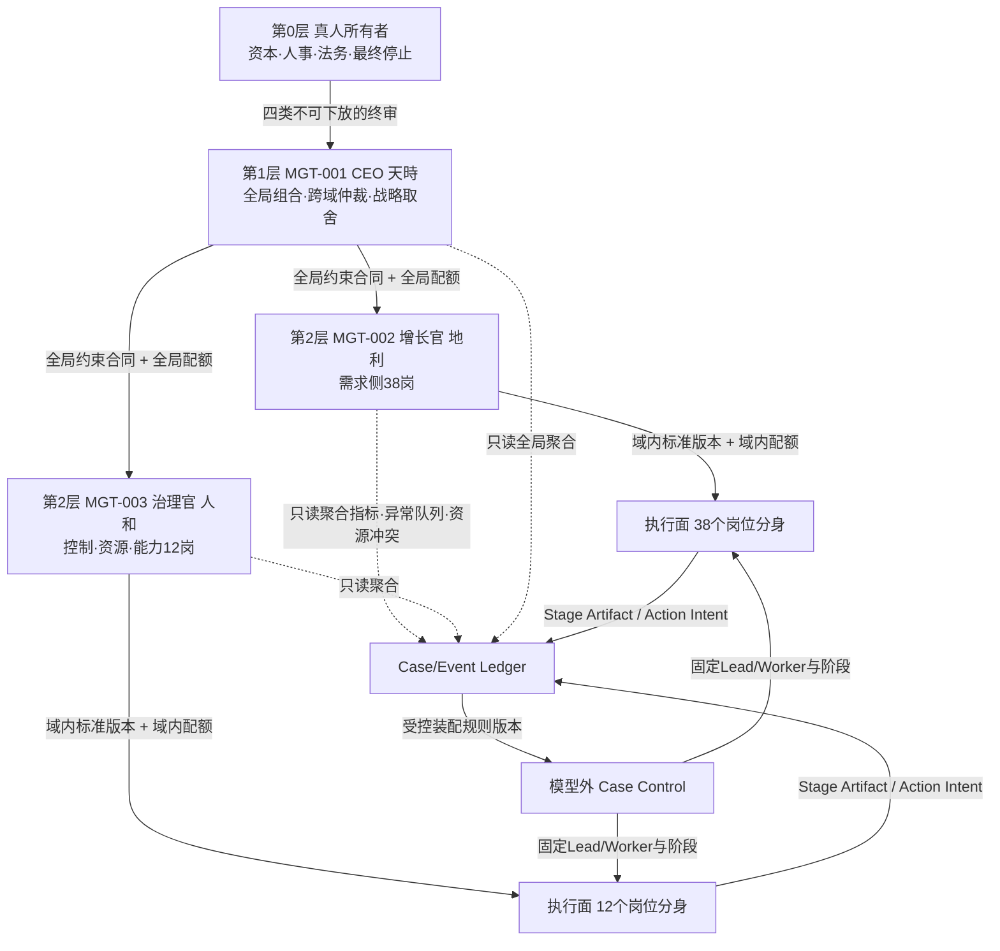

# AI组织管理层：1个CEO + 2个二级负责人的三级结构设计

状态：设计完成，待用户确认决策权阶梯与管理域契约的正式化（见文末待决清单）。本文不改变D-022「50个岗位不设上级Agent」的结论，而是明确该结论**只适用于执行面**；管理层是决策权层，不进入Case执行链路，不持有资产权限，也不与岗位分身对话。生产授权仍为零。

结构版本说明：本设计的**v1曾采用9个管理岗位**（1个CEO + 8个CXO）。用户在2026-09-18决定不采用8个二级负责人，改采本v2的3岗位结构。v2不是v1的裁剪，而是重新划域：8个CXO的合并会制造一个v1没有的失效模式（§5），该失效模式的处理是v2的承重设计之一。

## 1. 为什么需要这一层

v2.3的50个岗位、9条价值流、20个场景和八阶段门禁回答了「一件事怎么被正确地做完」，但没有角色回答「哪些事值得做、谁先做、放弃什么、谁来承担组合结果」。场景内已经通过产物门禁解决了协同质量问题，缺的是**组合层的取舍责任**。

三个具体缺口：

1. **资源竞争无人裁决**：多张Case争抢同一账号、同一商品、同一预算、同一时段时，装配规则只保证不冲突，不保证择优。
2. **标准没有所有者**：装配规则、风险阈值、验收标准由AGT-002维护和分发，但「哪一版进入Production」没有责任主体，与D-022「AI不能发布自己的配置」之间缺少人侧的对应角色。
3. **组合结果无人负责**：每张Case都有唯一AI结果负责人，9条价值流都有默认Lead，但价值流之上没有角色对「本季度GMV结构、库存风险、合规暴露、平台成本」的整体走向负责。

## 2. 第一性原理：只补被搬走的活，不重建被消灭的活

外部证据显示两件事同时成立，这决定了本层设计的唯一正确形态。

**证据一：管理层的「信息中继」职能已经被消灭，而且不该被AI重建。** Gartner预测到2026年20%的组织会用AI扁平化结构、削减超过一半的中层管理岗位；2022–2025年上市公司经理人数下降6.1%（[Lepaya, The Great Flattening](https://www.lepaya.com/blog/insights-great-flattening-middle-management-ai)）。本项目在v2.3已经用产物门禁协议主动消灭了同样的职能：岗位之间无隐式会话、无Agent互聊、只以已验收ArtifactEnvelope交接。**如果二级负责人做成消息中继层，就是用AI重建刚被删掉的东西。**

**证据二：中继职能被搬走后，其职责往往向上堆积且无人接手。** Korn Ferry 2025数据显示，37%的员工因缺少管理者而感到方向不清，近一半高管怀疑自己无力管理堆积上来的事务（同上来源）。对应到本项目：如果不在价值流之上明确取舍责任，所有跨域冲突会全部堆到真人所有者一个人身上——这正是"人为低效沟通"的另一种形态。

**因此本层的职能被严格限定为四类决策权，不含协调与转述：**

| 保留（本层所有） | 禁止（本层绝不做） |
| --- | --- |
| 标准与装配规则的版本所有权 | 转述、催办、汇总结下级的叙述性汇报 |
| 资源配额与优先级排序 | 参与单张Case的阶段推进或方案编写 |
| 域内结果的组合责任 | 与50个岗位发生会话、下发口头指令 |
| 升级与冻结判断（含向上呈报） | 持有业务系统写权限、Service Identity或凭据 |

**成本约束（必须写进设计，不能留给运行期）**：Anthropic实测多智能体架构约为单智能体token消耗的15倍，其质量增益集中在可并行的研究型任务上（[techiehub汇总](https://techiehub.blog/multi-agent-ai-systems)）。本层因此采用**离环节拍 + 聚合输入**，而非实时在环：管理层每个周期只处理已聚合的确定性指标、异常队列与资源冲突清单，不接触Case明细原文。这一条同时是成本控制与信息保真的关键——聚合账本不会像转述一样失真。

**证据三（本项目已核实的一手受控实验，同时对本层有利与不利）**：Yubin Kim 等《Towards a Science of Scaling Agent Systems》（[arXiv:2512.08296](https://arxiv.org/abs/2512.08296)；180 个受控配置 × 4 个 agentic 基准 × 3 个 LLM 家族，匹配 token 预算）测得误差放大因子：**单 agent 1.0 / 集中式编排 4.4（95% CI [3.8, 5.0]）/ 混合 5.1 / 去中心化 7.8 / 独立式 17.2（95% CI [14.3, 20.1]）**，原文机制为「Centralized coordination… contains this to 4.4× by enforcing **validation bottlenecks that intercept errors before aggregation**」。

这条证据对本层**双向**，两边都必须写进设计：

- **支持本层**：集中式编排是五种结构里除单 agent 外最优的一档。本层的四类决策权恰好就是一个"在汇总之前拦截错误的验证瓶颈"，且本层不参与Case执行，比实验中的集中式编排更远离误差传播路径。
- **限制本层**：集中式的 **4.4× 仍然远高于单 agent 的 1.0×**，token效率（每 1,000 token 的成功数）从单 agent 的 **67.7** 掉到集中式的 **21.5（差 3.1×）**；且同一研究测得**单 agent 基线准确率超过约 45% 后，增加 agent 出现负回报（β̂=−0.404, p<0.001）**，作者结论「per-agent reasoning capacity becomes prohibitively thin **beyond 3–4 agents**」，**顺序推理任务上所有多智能体变体性能下降 39–70%**。

**因此本层不是"因为多智能体更好"而存在，而是"因为单个Agent无法同时承担跨域取舍责任"而存在。** 这条区别决定了处置：若影子运行发现某个管理域的判断可以被一个通用管理Agent以更低成本完成，正确处置是**撤销该岗位而不是优化它**——该情形已写入 §10 的层数复审与 §12 的 MGT-Q5。

## 3. 三级结构

数据是**单向**的：执行面写账本，管理层读聚合，管理层写标准与配额，Case Control按版本执行。管理层与执行面之间**不存在会话边**。

## 4. 管理域划分

分组依据不是照搬部门，而是**需求侧与治理侧的分离**：一侧对增长结果负责，另一侧对边界、资源与能力负责。这一刀切在「谁对收入负责」与「谁对约束负责」之间，而不是切在业务量之间。

| ID | 分身 | 岗位 | 管理域 | 直接覆盖岗位 | 覆盖数 | 主要结果 |
| --- | --- | --- | --- | --- | --- | --- |
| MGT-001 | 天時 | 首席执行官 CEO | 全局组合 | MGT-002、MGT-003 | 2 | 全局组合决策包 |
| MGT-002 | 地利 | 首席增长官 CGO | 渠道·品牌·增长·服务·履约·产品 | AGT-001~004、006~039 | 38 | 增长组合决策包 |
| MGT-003 | 人和 | 首席治理官 CGOv | 财务·合规·质量·账号·数据与AI平台 | AGT-005、040~050 | 12 | 治理与能力决策包 |

覆盖校验：两个管理域的直接覆盖面并集为 AGT-001~050 全部50个岗位，**无遗漏、无重复归属**。

### 4.1 双线归属已消除（相对v1的结构性改进）

v1的8-CXO结构中有**5个岗位被两个CXO同时覆盖**（AGT-002、018、027、038、044），即矩阵式双线汇报。v2把这些岗位各自归入单一管理域，双线归属数降为**0**：

| 岗位 | v1归属 | v2归属 | 消除理由 |
| --- | --- | --- | --- |
| AGT-002 场景自主编排与异常协调 | MGT-002 COO + MGT-009 CQO | MGT-002 | 它的活是「Case怎么装」，属业务执行侧 |
| AGT-018 生产协同与质量控制 | MGT-005 CTO + MGT-009 CQO | MGT-002 | 质量事件的**结果责任**本就在此岗，不因横切角色而转移 |
| AGT-027 店铺账号健康与规则 | MGT-004 CMO + MGT-009 CQO | MGT-003 | 账号合规属控制边界，不属营销 |
| AGT-038 体验洞察与质量反馈 | MGT-008 CCO + MGT-009 CQO | MGT-002 | 体验洞察是需求侧经营输入 |
| AGT-044 产品合规与隐私 | MGT-006 CRO + MGT-009 CQO | MGT-003 | 与AGT-043同域，本就属治理 |

v1用「横切事件状态权」解释了MGT-009的重复覆盖。v2不再用角色横切解决，而用**事件队列按类型确定性分派**解决（§6），因此不需要一个横切岗位。

### 4.2 关键划界（防止两个角色抢同一件事）

| 边界 | 归属 | 理由 |
| --- | --- | --- |
| 装配规则的**作者** | AGT-002（归MGT-002域） | 制度内容由专业岗位产出 |
| 装配规则的**所有者与发布决策** | MGT-003 治理官 | 与D-022「AI不能发布自己的配置」互补，人侧对应角色必须存在 |
| 质量与账号事件的**结果责任** | AGT-018 / AGT-027（未转移） | 事件状态权不再由独立角色持有 |
| 独立控制的**产能与标准** | MGT-003 治理官 | 域内资源与标准 |
| 独立控制的**否决上报通道** | 直达MGT-001与真人所有者 | 独立性不许被经营目标污染；见§5.2 |
| 指标口径的**冻结权** | AGT-005 + 外部复核，**不归MGT-003** | v2的承重设计，见§5.1 |

注：**规则作者的归属线与其产物的版本所有权分离**是本设计的刻意选择。AGT-002在组织上归增长域（它服务的是Case装配效率），但它产出的装配规则版本由治理官持有发布决策。这样既不制造双线汇报，也不让规则作者与规则发布者同属一人。

## 5. 合并带来的失效模式及其处置（v2的承重设计）

把8个CXO合并为2个，会制造一个v1不存在的结构性风险。**这一节是v2能否成立的关键，不是补充说明。**

### 5.1 新增失效模式：治理官同时是评估者与被评估者

v1用三个不同身份分担了「指标」这条链：MGT-007 提出并维护指标口径、MGT-006 持有合规边界、MGT-001 裁决争议。v2里这三件事全部落进**MGT-003 治理官**一个身份：

| 环节 | v1责任方 | v2若无处置 | 后果 |
| --- | --- | --- | --- |
| 指标口径草案与维护 | MGT-007 CAIO | MGT-003 | — |
| 口径独立冻结 | AGT-005，争议上升MGT-006 | MGT-003自身 | 自定尺子 |
| 争议裁决 | MGT-001 | MGT-001 | 而CEO的排序依据正是该尺子 |

结果：治理官用一个自己起草、自己参与冻结的口径，去产出CEO用来评估包括治理官自己在内的排序输入。这正好违反本项目已反复确认的「平台岗位不能自我验收」。

**处置（三条，缺一不可）：**

1. **口径冻结权不下放给治理官**。指标口径由AGT-005内控审计与独立复核冻结；治理官只有提出与维护权，无冻结权。**口径未冻结的指标不得进入排序**（沿用v1规则）。
2. **涉及治理官自身的口径争议，裁决方是真人所有者，不是CEO**。理由：CEO的排序输入就是争议标的，CEO不具备裁决该争议的独立性。这是v2对v1的**权力上移**，不是简化。
3. **AGT-005的独立复核线不向MGT-003汇报**。AGT-005在组织覆盖上属治理域，但其复核结论与冻结权直达MGT-001与真人所有者；治理官不得修改、延迟或压后其冻结。这与v1「独立控制的否决上报通道直达CEO与真人」同构。

### 5.2 治理官的指标豁免（沿用并加强）

治理官若与增长官使用同一组组合指标（组合偏差、增量），会产生"在合规上让步以改善组合结果"的激励。因此治理官评估**剔除组合偏差与增长类指标**，只使用：

| 治理官专用指标 | 说明 |
| --- | --- |
| 边界判定周期 | 从请求到结论的时长 |
| 否决正确率 | 事后被外部事实支持的比例 |
| 被事实推翻率 | 结论被后续外部依据推翻的比例（反向指标） |
| 暴露收敛时长 | 从识别到收敛 |
| 证据缺口收敛率 | 合规证据补齐速度 |
| 例外请求数 | 业务提出"破例"的次数；上升说明边界沟通不足 |

治理官的否决权**经约束记录生效**：不直接改写Case，不绕过Policy Gate；产出的强制约束以`constraint_refs`形式被Policy Gate读取，命中即`HOLD`或`DENY`。独立性由模型外机制保障，不靠人格自律。

### 5.3 契约上限：本层与已核实的多智能体上限如何相交（v2新增）

前节的实测上限**不适用于本层的结构关系，但适用于本层的规模主张**。这个区别必须写清，否则会误推出两个相反的错误结论。

| 实测上限 | 出处 | 适用范围判定 | 本设计的处置 |
| --- | --- | --- | --- |
| 固定算力下「per-agent reasoning capacity becomes prohibitively thin **beyond 3–4 agents**」 | [arXiv:2512.08296](https://arxiv.org/abs/2512.08296) | **不适用于**本层结构关系：该限制针对在同一任务上并行推理的 agent，本层是决策权平面且不进Case执行链 | 但**适用于任何"把管理判断拆给更多Agent"的提议**：本层不得以"再加一个管理岗位"的方式扩容 |
| agent 拥有「**more than 30-40 choices of action**（tools, topics, and other agents）」时开始退化 | Microsoft《multi-agent-patterns》（Last updated 2026-05-22 / 2026-05-15） | **部分适用**：本层每个岗位可见工具类别仅 4 类，远低于阈值；但"other agents"一项在本层为 38 与 12 | 把该阈值转成**监控指标**而不是硬上限：见下 |
| 「**AWS Budgets alerts on orchestration-to-execution ratios and supervisor-to-worker ratios**」 | AWS Well-Architected Agentic AI Lens（2026-06-10） | **可移植**：这是本轮调研中唯一把上下级比例写成监控指标的官方文档 | 采用为 §10 的监控项：**增长官 38:1、治理官 12:1** |

**为什么用监控而不是硬上限**：本层两个岗位的 38:1 与 12:1 都**高于任何已核实的公开参考值**（Salesforce 官方推荐每个 orchestrator 最多 7 个 Connected Subagent；Anthropic 实测 lead agent 并行启动 3–5 个）。但这两条都不描述本层的结构关系——Salesforce 的 7 是**同时路由**的直连子代理数，Anthropic 的 3–5 是**并行扇出**度，而本层既不路由也不扇出，只发布版本与配额。**因此不能拿 7 或 5 直接判本层超限。**

可以把数字转成可执行约束的部分是：**若某个域的例外队列持续积压，第一处置是规则下沉（§5.4），第二处置才是调整域边界，且不得以新增岗位作为处置。** 上下级比例作为预警信号进入 §10 的监控，触发复审而非自动动作。

### 5.4 增长域的决策密度风险及处置

增长官直接覆盖38个岗位，是治理域的三倍以上。**这不是「管得宽」的问题，而是决策密度问题**：38个岗位的例外、冲突与配额请求会全部经过一个身份。

处置不是再切一刀（那会回到加层），而是**把可按规则处理的决定下沉**：

1. **已发布规则内的判定不下沉到增长官**：命中已发布标准与确定性规则的资源、优先级、异常判定，由Policy Gate与Case Control按表执行（L0），不产生管理决策。增长官只处理规则未覆盖的例外。
2. **上升条件前置且机械可判**：影响另一域、超出已批准配额包、触发控制边界、同一事项两次HOLD——命中任一即上升，不需要增长官先做判断。
3. **不设增长官的第二层**：38个岗位不设中间层。若影子运行显示增长官的例外队列长期积压，处置是**改规则让更多决定下沉到L0**，而不是新增岗位。新增岗位只有在「规则无法表达该判断」被证实后才可提议，且仍须真人所有者L4批准。

## 6. 管理运行节拍

| 节拍 | 参与 | 输入（只读聚合） | 输出 |
| --- | --- | --- | --- |
| 日 | MGT-002、MGT-003（**分队列**，见下） | 异常队列、现金与结算状态、重大事件状态 | 冻结建议、升级单 |
| 周 | MGT-001、MGT-002、MGT-003 | 域内KPI、Case组合、资源冲突清单、未决决策队列 | Decision Package、配额调整 |
| 月 | MGT-001、MGT-002、MGT-003 | 2域决策包、全局组合、能力供给与运行审计 | 全局组合决策、优先级排序版本 |
| 季 | MGT-001 + 真人所有者 | 季度组合、组织能力、ROI归因 | 战略取舍、GOC契约修订 |

**日节拍必须分队列，不能让治理官独占。** v1的日节拍由COO、CFO、CQO三人参与；v2只剩2个二级负责人，若把日队列全部交给治理官，治理官会成为唯一瓶颈。因此按异常类型确定性分派：

| 队列 | 归属 | 内容 |
| --- | --- | --- |
| 经营执行异常 | MGT-002 增长官 | 渠道指标结构性变化、履约与质量异常、账号健康事件、库存与交期预警 |
| 控制与资源异常 | MGT-003 治理官 | 合规与隐私暴露、资金与结算异常、权限与数据质量问题、平台运行事件 |

分派规则是**机械可判的**：异常单自带类型字段，按类型入队，不需要任何一方先做判断。类型无归属时进入`HOLD`并记自治异常，不由任一岗位自行认领。

任何管理岗位**不得**在节拍之外介入单张Case；唯一例外是阈值触发的模型外升级，此时管理层作为接收者出现，不改变Case的Lead与阶段。

## 7. 每个二级负责人的四类决策权

二级负责人的权力不是「管人」，而是下列四类决策。四类之外的任何事项都不属于该岗位。

| 决策类型 | 具体内容 | 生效机制 | 频率 |
| --- | --- | --- | --- |
| **标准所有权** | 决定本域价值流优先级、风险阈值、验收标准、装配规则的哪一版进入Production | 发布版本化的管理域契约，由模型外Case Control读取执行 | 月 |
| **资源配额** | 分配预算、算力、并发、时间段，裁决多Case争抢同一对象时的先后 | 写入资源预留与配额记录 | 周 |
| **组合取舍** | 对本域内的Case集合做出继续/停止/缩小/扩大的建议，形成决策包 | Decision Package提交CEO或真人所有者 | 周/月 |
| **升级与冻结** | 域内出现无策略、回执不明、超阈值暴露时的冻结发起与升级呈报 | 冻结建议 + 升级单，进入既有Policy与异常通道 | 随时（事件触发） |

**二级负责人不拥有的**：对Case的装配指令权（归Case Control）、Action Intent的策略模板提案权（本设计不授予，见§10待决）、任何资产写权限（归Execution Broker）、任何岗位的Prompt/Skill/Bundle修改权（归五契约流程）。

上述四类决策要真正生效，还需要一个独立的生效机制：MDC/GOC的最小机器可读schema、包含关系校验、资源预留与队列语义、指标口径的独立冻结、以及域标准更新的追溯性规则。**缺这一环时，MDC/GOC只是版本化文档，即没人执行的制度**；具体设计见[管理层决定的生效机制](management/ENFORCEMENT.md)。

## 8. CEO的四类全局决策权

MGT-001同时拥有全部四类二级负责人决策权的全局版本，并额外承担下列四类只在全局层成立的事项：

1. **跨域仲裁（已按证据降级为兜底机制，v2修订）**：增长官与治理官的管理域冲突时（如增长要折扣、治理要毛利与合规），CEO在已批准的企业约束内裁定，裁定结果落为版本化的全局约束，不落为对Case的指令。**例外**：争议标的为指标口径且涉及治理官自身时，见§5.1第2条，裁决方是真人所有者。

   **降级依据（本轮调研新增，且与本层此前的假设相反）**：六个多智能体框架里**没有任何一个把"冲突仲裁"写成 manager 的明文职责**；CrewAI 是唯一把"验收"写成 manager 职责的框架，Anthropic / OpenAI SDK / AutoGen / CrewAI 在 manager 定义层面均未记载仲裁职责。更直接的反证来自 Cursor 的生产实测：初期设置的 integrator（质量与冲突仲裁角色）「**created more bottlenecks than it solved**」，移除后反而更好，其结论是「**Too little structure and agents conflict, duplicate work, and drift. Too much structure creates fragility.**」

   对应处置有三条：
   - 仲裁次数必须**单调下降**。每次裁定都要求产出"哪条确定性规则本可避免该冲突"；若同一类冲突被仲裁第二次，该次仲裁计为**失败**而非工作量。
   - 本岗位**不得在§6节拍之外主动寻找冲突来仲裁**；只受理由机械条件（§5.4第2条）上升的事项。
   - 「跨域仲裁周期」指标的**目标不是变快，而是变少**。周期缩短但次数上升，判定为设计失败。
2. **全局组合取舍**：对2域的资源再分配，包括在同一已批准预算包内跨域调整配额。这是CEO相对二级负责人的实质增量权力。
3. **战略停止权**：任何价值流、场景、能力供给出现结构性失败时的停止发起权（不含自动恢复）。
4. **对真人所有者的四类呈报**：资本与预算终审、人事与组织变更、法律与对外承诺签署、最终停止确认。

CEO的权限边界与已确认的D-011（GMV第一但原始GMV/取消退款/经营约束分开呈现）、D-029（模型只产出Action Intent）一致：它是决策准备者与全局视野所有者，不是资金所有者。

## 9. 与既有50岗位资产的关系

| 既有资产 | 本层是否需要 | 说明 |
| --- | --- | --- |
| Soul Contract | 需要 | 3份新Soul，与50份同结构 |
| Role Playbook | 需要 | 3份新Playbook，与50份同结构 |
| Preset Blueprint | 需要 | 3份新蓝图，工具面显著窄于执行岗 |
| 五份契约 | 需要 | 见§9.1新增第六类契约 |
| 八阶段协议 | 不适用 | 管理层不运行Case阶段 |
| 价值流Lead | 不适用 | 管理层不作为Lead或Worker出现在任何Case中 |
| Access Contract | 需要（更严） | 见§9.2 |

### 9.1 新增契约类型：管理域合同（Management Domain Contract）

既有五契约（Business、Skill、Runtime、Access、Assurance）描述**一个岗位如何正确地做事**。管理层需要描述**一个域按什么标准与配额运行**，因此新增第六类契约：

| 契约 | 定义 | 所有者 | 变更频率 |
| --- | --- | --- | --- |
| 管理域合同 MDC | 域范围、成员岗位、标准版本引用、资源配额、风险阈值、升级规则、组合目标、评估口径 | 该域二级负责人 | 月 |
| 全局约束合同 GOC | 跨域约束、全局配额包、优先级排序、战略停止清单 | CEO | 季 |

MDC与GOC都是版本化、不可变、带Hash的发布物，由模型外Case Control与Policy Gate读取；管理层只能提出新版本候选，不能绕过发布门禁自发布。这与D-022完全一致——管理层同样受「不能自己发布」约束，区别只在于它拥有**提出与决策哪一版进入下一个状态的权力**。

### 9.2 Access边界

按已确认选择，3个管理岗位采用**只读聚合视图**：

- 可见：Case/Event Ledger聚合指标、异常队列、资源冲突清单、已验收Stage Artifact的**摘要与引用**。
- 不可见：业务系统原始数据、客户明细、员工资料、凭据、Token、未验收产物原文。
- 不持有：Service Identity、任何写工具、任何Action Intent发出能力。管理层的结论只能通过标准版本与配额生效，不能变成动作。

这条边界使管理层的权限面**窄于**任何一个数据与平台岗位，从机制上消除了「高层越权读全量数据」的风险。

## 10. 评估：如何证明这一层创造了ROI而不是新增了成本

管理层的失败模式是「多了一层延迟与成本，却什么都没改变」。因此每个管理岗位必须有可反证的指标，且允许被判定为冗余：

| 指标 | 定义 | 反证含义 |
| --- | --- | --- |
| 决策周期 | 从决策包生成到版本发布的时长 | 过长说明层在拖慢经营 |
| 例外升级率 | 升级到真人所有者的比例 | 过高说明层未承接该承接的判断 |
| 标准复用率 | 域内Case复用既有标准而非新建的比例 | 过低说明标准形同虚设 |
| 配额利用率 | 分配资源被实际使用与产出的比例 | 过低说明配额分配脱离实际 |
| 域内组合偏差 | 域目标与实际经营结果的差距 | 无法改善则本层无存在理由 |
| 单域例外积压 | 该域未处理例外队列的时长与条数 | 积压说明域过宽或规则下沉不足（v2新增，见§5.3） |
| 管理层成本占比 | 3个管理岗位的运行成本 / 全组织运行成本 | 超过阈值即触发层数复审 |
| 上下级比例 | 域内岗位数 / 该域负责人数（当前 38:1 与 12:1） | 比例上升而例外队列未积压＝健康；比例上升且队列积压＝规则下沉不足。采用 AWS 的 supervisor-to-worker ratio 监控口径（§5.3） |
| 单域规则下沉率 | 该域决定中降为 L0 确定性判定的比例 | 长期不升说明本层在逐单裁决同类事项，是"加层不加值"的先行指标 |

**层数复审触发条件（设计内置）**：若连续两个季度某管理域无法在决策周期、组合偏差、例外升级率三项中至少改善两项，该岗位进入`MGT_REVIEW`，候选处置为**合并为单域、降级为制度岗位或撤销**。管理层不是永久结构。

v2新增一条前置复审条件：**若单域例外积压指标持续超阈值，先审规则下沉而不是审岗位增减**——因为该指标高通常说明"该下沉到L0的决定没有被下沉"，而减少岗位会让它更糟。

**本节指标怎么被真正检验**：上表指标不靠"抽看几份决策包"验收，而是走[影子验证设计](management/SHADOW-VERIFICATION.md)的六道门（`MGT-EVAL-A/B/C/R/R0/R2`）。v2验证语料已冻结：[management-eval-corpus.v2.json](management/eval/management-eval-corpus.v2.json)（25用例，L-A 12 / L-B 13，含L2b识别与约束强制追溯），v1语料保留为结构变更的追溯记录。**语料冻结不等于验证已执行**：`MGT-EVAL-B`仍需两次隔离运行与台账，`MGT-EVAL-C`依赖三个未实现构件，判定"本层是否应该存在"的门是`MGT-EVAL-R0`（对照臂，见§12的MGT-Q5）。

## 11. 与外部证据的一致性声明

- 本设计**不主张**AI组织需要传统中层；它只主张组合层取舍责任必须有人承接，且承接方式必须排除信息中继（§2）。
- 本设计**不主张**已有企业验证过3人管理层配50个AI岗位的比例；该比例是本项目的设计选择，须经影子运行验证，属于未验证假设。
- 本设计**不主张**3优于9。用户的取舍是减少协调面，代价是单域变宽与治理官的自我评估风险（§5）；这两项代价已用机制处置，但其有效性同样未验证。
- 本项目当前没有真实运行数据，因此§10全部指标**尚无基线**，不得当作已实现效果。

## 12. 待决清单

| 编号 | 事项 | 影响 |
| --- | --- | --- |
| MGT-Q1 | MGT-ID命名空间是否正式采用（保留AGT-001~050不变） | 资产索引、生成器、Site数据 |
| MGT-Q2 | 管理域合同MDC是否正式成为第六类契约 | 五契约管理图、AGENT-MANAGEMENT-GRAPH |
| MGT-Q3 | 二级负责人是否获得Action Intent策略模板的提案权（本设计当前不授予） | 与AGT-050、Policy Gate职责边界 |
| ~~MGT-Q4~~ | 已随v2失效：v1的MGT-009横切事件状态权已由§4.1与§6的按类型队列分派替代，不再有横切岗位需要细化 | 重大事件恢复流程 |
| ~~MGT-Q5~~ | 已按建议执行：确立`MGT-EVAL-A/B/C/R`四道门；v2因管理层仅3岗，改为**全部3岗位同时先验**（v1的三岗位子集已无意义） | 落地门禁 |
| ~~MGT-G7~~ | v2已定：指标口径冻结方为AGT-005+外部复核并用；涉及治理官自身的争议上升真人所有者（§5.1） | 指标口径独立性 |
| MGT-Q5 | **是否把"单一通用管理Agent"设为影子运行的对照臂**（§2证据三：单agent基线>约45%后加agent为负收益，而本项目管理判断的正确性基线未知） | 直接决定3岗位结构是否值得保留；不做对照臂则该结论永远无法被反证 |
| MGT-G3 | 是否采用MDC最小机器可读schema，并把「MDC超出GOC范围」设为拒绝而非自动截断 | 管理决定的生效机制（已由D-061确认） |
| MGT-G4 | 控制边界是否强制追溯在跑Case，是否需要真人所有者显式授权 | 在跑Case的一致性与边界控制（已由D-061确认） |
| MGT-G6 | 优先级是否需要抢占能力（当前设计不允许抢占已提交预留） | 资源预留与队列语义（已由D-061确认） |
