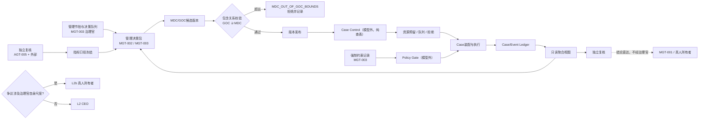

# 管理层决定的生效机制

状态：设计完成；MGT-G3、MGT-G4、MGT-G6已于2026-09-18由用户确认（见D-061）。本文回答一个具体问题：**管理层的决定靠什么真正生效？** 缺这一环时，MDC/GOC只是"版本化文档"，即没人执行的制度。

结构版本：本文的v1对应9岗位结构。v2对应3岗位结构（CEO + 增长官 + 治理官）。D-061确认的三项基线**全部不变**；变动是责任方从9个岗位收敛到3个，并新增一项因收敛而必须补的机制（MGT-G8）。

## 0. 六个承重缺口

| 缺口 | 问题 | 本文处置 | 状态 |
| --- | --- | --- | --- |
| MGT-G1 | 管理节拍本身无主：谁排决策队列、谁统计决策周期 | 定义为治理官的技能与交付物，**排除增长官兼任**（§1） | 设计已定 |
| MGT-G2 | CEO的输入由被评估方自己定义（v1：MGT-007既供指标又定义指标） | 指标口径由独立复核冻结，治理官只有维护权（§2） | 设计已定（v2收紧） |
| MGT-G3 | 优先级没有执行机制：Case Control保证不冲突，不保证择优 | 定义管理域合同的最小机器可读schema | ✅ 已确认（D-061） |
| MGT-G4 | 域标准更新与Case已固定Bundle冲突：在跑Case是否追溯 | 默认不追溯 + 控制边界强制注入例外 | ✅ 已确认（D-061） |
| MGT-G5 | 独立控制被组合指标污染 | 治理官评估指标豁免组合偏差 | 设计已定 |
| **MGT-G8** | **治理官同时是尺子的作者、尺子的维护者与尺子的被评估者** | **L2b裁决上移真人所有者 + 复核线不向其汇报**（§5A） | **v2新增，设计已定** |

## 1. MGT-G1：管理节拍的所有权

**问题**：管理层按日/周/月/季运行，但"节拍"本身不是一个自然产物——没有人负责产出决策队列、保证决策包按时到场、统计决策周期。没有这个角色时，节拍会退化为"想起来才开一次"。

**补法**：把「管理节拍运行」明确为 **MGT-003 治理官**的常设交付物，产出**管理节拍日历与决策队列**：本期必须裁决的事项、责任人、输入是否齐备、到期时间、上期未闭环项。

**为什么不是增长官（v2决定）**：v1把节拍运行放在COO（流程·制度·组织域），因为该域与经营结果无直接利益关系。v2的两个二级负责人都是经营相关方，若把排程权交给增长官，等于让最需要及时决策的一侧控制决策的排期——它可以延迟对自己不利的事项。治理官的评估指标本身不含增长类指标（§5），且其职责天然包含约束与秩序，因此排程权归治理官。

**这一归属的代价必须写明**：治理官因此同时持有排程权与边界权。制衡不来自角色设计，而来自三条外部机制：
1. 决策队列是**公开清单**，任一条目的齐备性与到期时间可被CEO与真人所有者直接读取；
2. **超期未决不是治理官的决定权**：超期事项按`DECISION-RIGHTS.md`§3自动上升一级或进入HOLD，治理官无权让某事项保持在队列中不上升；
3. 若增长官主张某事项被不当延迟，该主张走**L2b**（真人所有者），不经CEO——因为CEO的排序输入可能受同一延迟影响。

**划界**：治理官拥有"决定机器"（排程、齐备性、时效、台账），CEO与增长官拥有"决定"本身。治理官不得替任何域判断其决定的内容，也不得因为某域未按时提交而代其作出决定。

**验收**：决策队列的齐备率、决策周期（从决策包生成到版本发布）、超期未决事项数、**队列条目被压后次数（v2新增）**。

## 2. MGT-G2：指标口径的独立冻结（v2收紧）

**问题**：CEO 的排序输入是各域的组合指标（组合偏差、决策周期、例外升级率、标准复用率、配额利用率）。这些指标的口径若由治理官定义，则被评估的域同时定义了评估自己的尺子。这违反本项目已反复确认的"平台岗位不能自我验收"原则。

**v1的处置为什么在v2不够用**：v1让MGT-007（数据与AI官）提案、AGT-005独立复核、争议上升MGT-006（合规边界）与MGT-001。这三个身份在v2合并进了治理官与CEO两人，其中CEO本身就是口径的使用者。因此v2必须把**冻结权与争议裁决权同时移出治理官**。

**补法**：管理层的指标口径按**独立复核**路径冻结：

| 环节 | 责任方 | 权限 |
| --- | --- | --- |
| 口径草案 | MGT-003 治理官 | 提出与维护 |
| 独立复核 | AGT-005 内控审计与独立复核，或指定外部复核 | **冻结版本、可否决草案** |
| 变更 | 治理官提出新版本 → 独立复核 → 发布 | 任一方缺失即保持旧版本 |
| 争议（不涉治理官自身） | 上升 MGT-001 | CEO是口径使用者，非被评估者 |
| 争议（涉治理官自身评估尺度） | 上升 **L2b 真人所有者** | CEO的排序输入即争议标的，不具备独立性 |
| 涉及管理层整体 | 外部复核 | 内部复核对管理层自身无独立性 |

**关键约束**：指标口径版本的冻结记录必须与MDC版本一同发布，CEO才能使用该指标作为排序依据；**口径未冻结的指标不得进入排序**。

**复核线的独立性（v2新增机制）**：AGT-005在组织覆盖上属治理域，但其复核结论与冻结权**不向MGT-003汇报**，直达MGT-001与真人所有者。治理官不得修改、延迟、归档或压后其冻结结论。违反时按`DECISION-RIGHTS.md`§4「压后复核」反模式检出。

## 3. MGT-G3：MDC/GOC的最小机器可读schema（已确认）

**问题**：优先级与配额必须能影响Case Control，但 D-057 明确禁止模型驱动路由、D-024 要求装配确定性。因此不能把"优先级"写成一段自然语言让Case Control理解。

**解法**：把管理层的决定收敛为一个**小而可枚举的机器可读契约**。Case Control 不做判断，只做表查询。管理层决定"值"，Case Control 决定"怎么按表执行"，两者不重叠。

### 3.1 MDC 最小字段

| 字段 | 含义 | 取值示例 | 谁写 |
| --- | --- | --- | --- |
| `mdc_id` / `version` / `hash` | 不可变版本标识 | `MDC-D1-1.2.0` | 该域负责人 |
| `domain` / `member_role_ids` | 域与成员岗位 | `demand_side` / `[AGT-001..004,006..039]`、`governance` / `[AGT-005,040..050]` | 该域负责人 |
| `scope_selector` | 作用范围（对象类型+标识模式） | `channel=amazon_us`、`product_family=wearable_breast_pump` | 该域负责人 |
| `priority_class` | 优先级类别（枚举，非自由文本） | `P0`/`P1`/`P2`/`P3` | 该域负责人 |
| `quota` | 资源上限（按对象类型分别声明） | `compute_units_per_week`、`concurrent_cases`、`budget_envelope_ref` | 该域负责人（受GOC上限约束） |
| `reservation_policy` | 多个Case争抢同一对象时的处置 | `reserve_first_by_priority` / `queue` / `reject` | 该域负责人 |
| `constraint_refs` | 必须遵守的边界（合规、隐私、保留期） | `GOV-CONSTRAINT-0431`、`RETENTION-45D` | MGT-003 治理官 |
| `supersedes` / `effective_from` | 替代关系与生效时间 | 上一版本ID、时间戳 | 该域负责人 |
| `decision_package_ref` | 产生本版本的管理决策包 | `DP-D1-2026-W38-01` | 该域负责人 |
| `retroactive` | 是否作用于已在跑的Case | `false`（默认） / `true`仅限控制边界 | 见MGT-G4 |

`domain`取值在v2收敛为两个：`demand_side`（MGT-002 增长域）与`governance`（MGT-003 治理域）。v1的8域取值（含`market_growth`）在本版作废，**但已发布版本不追溯重写**——MDC是不可变发布物（§3.4），历史版本按其自身取值继续对已固定Bundle的Case生效。

### 3.2 GOC 与MDC的包含关系（防止域级决定违反全局约束）

```
GOC（CEO） ⊇ 每个域MDC的quota与priority_class取值范围
每个域MDC的constraint_refs ⊇ 全局强制约束（合规/隐私/保留期）
```

**硬规则**：域MDC的优先级与配额不得超过GOC授权范围；超出时Case Control直接拒绝该版本并记录`MDC_OUT_OF_GOC_BOUNDS`，不做自动截断（截断会静默改变管理层的决定，属于失真）。

### 3.3 Case Control 的执行（纯确定性，无模型判断）

| 情况 | 处置 |
| --- | --- |
| 请求范围命中`scope_selector`且配额未用尽 | 按`reservation_policy`预留或立即装配 |
| 命中但配额已用尽 | 按`reservation_policy`：`queue`进入等待、`reject`拒绝并记录 |
| 多个Case争抢同一对象且优先级不同 | 高`priority_class`先获得预留；同级按先到先得；不得抢占已提交的预留 |
| 命中`constraint_refs`中任一强制约束 | 拒绝，进入`HOLD_CONSTRAINT`，不因优先级豁免 |
| 无任何MDC覆盖该范围 | 使用全局默认（最低优先级、无预留），不猜测意向 |
| MDC版本超过GOC范围 | 拒绝该版本，`MDC_OUT_OF_GOC_BOUNDS` |
| 异常单类型无队列归属 | 进入`HOLD`并记自治异常，不由任一岗位自行认领（§6新增） |

**边界声明**：Case Control 到此为止。它不解释优先级的原因、不合并冲突的管理意图、不为某个域"通融"。管理意图的冲突必须在MDC提交前由CEO裁定，不得下沉到装配层。

### 3.4 优先级变更的在跑Case语义

优先级变更**只影响尚未完成的预留**，不追溯已开始的Case阶段。这与D-023"Case启动即固定Bundle"一致：已冻结的执行不应被事后改写。若CEO需要立即中止某张Case，走的是战略停止权与既有异常冻结通道，而不是修改优先级。

## 4. MGT-G4：域标准更新的追溯性（已确认）

**问题**：二级负责人在月中改了本域标准，而多张 Case 已按旧版本固定了 Bundle。D-023 说 Case 启动即固定 Bundle，但设计没有说明"标准更新"与"Bundle 固定"的优先关系。

**规则**：

| 变更类型 | 是否作用于在跑Case | 理由 |
| --- | --- | --- |
| 优先级、配额、排序 | 只影响未完成预留 | 已开始的执行不应被事后改写 |
| 业务标准、验收标准、SOP | **不追溯**，仅对新Case生效 | 保持D-023的Bundle固定语义；需要立即生效时由CEO走战略停止或异常冻结 |
| 控制边界（合规、隐私、数据保留、账号规则） | **强制追溯**，立即注入所有在跑Case | 这不是管理偏好而是边界约束；不得因"已固定的Bundle"而继续越界 |

**执行方式**：控制边界不作为MDC字段承载，而作为独立的`constraint_refs`记录，由模型外Policy Gate在每次动作裁决时读取。因此它天然对在跑Case生效，且不需要改写Bundle。

**已确认边界（D-061）**：控制边界强制追溯在跑Case，且采用fail-closed。该规则会中断在跑业务，因此触发强制追溯时同步呈报真人所有者（L3），但**不等待批准即可生效**——等待批准会让越界在等待期间继续。

**v2补充**：控制边界的唯一发布方是MGT-003治理官。由于治理官同时持有排程权（§1），强制追溯的触发记录必须**即时同步**给CEO与真人所有者，不得进入常规决策队列等待排程——否则治理官可通过排程延迟自己的强制追溯记录被看见。

## 5. MGT-G5：独立控制的指标豁免

**问题**：治理官若与增长官使用同一组组合指标（组合偏差、增量），就会产生"在合规上让步以改善组合结果"的激励。

**补法**：治理官的评估指标**剔除组合偏差与增长类指标**，只使用：

| 治理官专用指标 | 说明 |
| --- | --- |
| 边界判定周期 | 从请求到结论的时长 |
| 否决正确率 | 事后被外部事实支持的比例 |
| 被事实推翻率 | 结论被后续外部依据推翻的比例（反向指标） |
| 暴露收敛时长 | 从识别到收敛 |
| 证据缺口收敛率 | 合规证据补齐速度 |
| 例外请求数 | 业务提出"破例"的次数；上升说明边界沟通不足 |
| **复核线独立性违规数** | 治理官修改／延迟／压后AGT-005结论的次数（v2新增，目标恒为0） |

同时，治理官的**否决权经约束记录生效**：不直接改写Case，也不绕过Policy Gate；产出的强制约束以`constraint_refs`形式被Policy Gate读取，命中即`HOLD`或`DENY`。这样独立性由模型外机制保障，而不是靠人格自律。

## 5A. MGT-G8：评估者与被评估者的同一化（v2新增承重缺口）

**问题**：v1用三个身份分担「指标」这条链（MGT-007提案、MGT-006边界、MGT-001裁决）。v2合并后全部落入治理官一人，而CEO的排序依据正是该口径。

**为什么不能靠"人格自律"解决**：口径的偏差通常是渐进且看似合理的（例如把某类投入计入或不计入增量）。没有任何单次行为看起来越界，因此行为验收抓不住它。

**处置（三条缺一不可）**：

1. **冻结权外置**：口径冻结权归AGT-005+外部复核，治理官只有提案与维护权（§2）。
2. **自涉争议上移L2b**：涉及治理官自身评估尺度的争议由真人所有者裁决，不经CEO（`DECISION-RIGHTS.md`§1.1）。
3. **复核线不向其汇报**：AGT-005结论直达MGT-001与真人所有者；违规按反模式检出并从治理官指标扣分（§5）。

**验收**：冻结记录签署方不得包含MGT-003；治理官的「复核线独立性违规数」恒为0；随机抽取3个已发布口径，检查其冻结签署方与争议处理路径是否符合L2b。

**为什么这三条必须是模型外机制，而不是人格或提示词约束（本轮调研新增的一手依据）**：AWS Well-Architected Agentic AI Lens（2026-06-10）的原文措辞是控制要「**enforced at the control-plane boundary … rather than relying on agent self-restraint**」；OWASP LLM06:2025 的两条关键缓解之一同为「**Implement authorization in downstream systems rather than relying on an LLM to decide if an action is allowed**」。这直接决定了本节的实现要求：

> **若目标Host只能通过Prompt层表达口径冻结权与复核线隔离，则MGT-003不得进入Shadow阶段。** 理由不是保守，而是本项目已确认的平台红线——提示词中的约束不构成服务端权限控制。把"我不冻结自己的口径"写在人格里而不写在签署校验里，等于没有这条机制。

可核对的机制形态有三个，缺任一即判定为"只有提示词"：① 口径冻结记录的签署方字段由发布门禁机械校验，含MGT-003即拒绝发布；② AGT-005的结论通道在权限层配置为对MGT-003只读；③ 强制追溯触发记录旁路决策队列直达CEO与真人所有者。

**残余风险（必须声明）**：真人所有者成为自涉争议的唯一裁决方，其判断负荷与专业性要求上升。本设计不主张这一机制已被验证有效，它是"减少角色数"这一取舍的**直接代价**，须在影子运行中用小样本检验：若L2b事项频次过高，说明3岗结构的独立性成本超过其协调收益，应触发`MGT_REVIEW`。

## 6. 生效链路（把补法串起来）



## 7. 待确认清单（增量）

| 编号 | 事项 | 本文建议 |
| --- | --- | --- |
| MGT-G3 | 是否采用§3的MDC最小schema，并把"MDC超出GOC范围"设为拒绝而非截断 | ✅ 已确认采用并拒绝（D-061） |
| MGT-G4 | 控制边界是否强制追溯在跑Case，以及是否需要真人所有者显式授权 | ✅ 已确认强制追溯 + fail-closed，同步呈报但不等待批准（D-061） |
| MGT-G6 | 优先级是否需要"抢占"能力 | ✅ 已确认不允许抢占；需要立即中断时走战略停止与既有冻结通道（D-061） |
| ~~MGT-G7~~ | 指标口径的独立复核方 | v2已定：AGT-005与外部复核并用；涉及治理官自身时外部复核，争议走L2b（§2、§5A） |
| MGT-G8 | 3岗结构下评估者与被评估者同一化的三条处置是否接受，以及L2b事项频次是否设为`MGT_REVIEW`触发指标 | 建议接受；建议把L2b季度频次>X设为层数复审触发条件（X待影子运行确定） |
| MGT-G9 | 管理节拍排程权归治理官后，是否需要在队列层面加一条"增长官可申请重新排程"的形式化通道 | 建议不加形式化通道；改用§1的三条外部机制，避免再造一层流程 |

## 8. 代码字号变更说明

本文件§3.1中`MDC-CMO-*`等含v1 CXO缩写的示例ID已改为域中性的`MDC-D1-*`（D1=增长域，D2=治理域）。**已发布的历史版本ID不重写**：MDC是不可变发布物，重写ID会破坏发布记录的追溯性，也会让已固定Bundle的Case找不到其装配依据。
