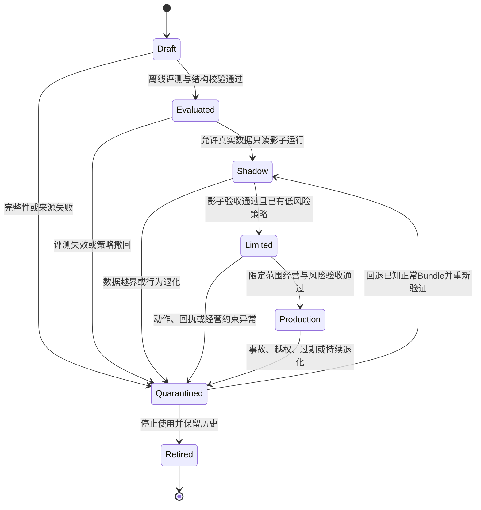

# Role Release Bundle与七状态岗位生命周期

状态：D-023与ADR-0005已确认。结构化状态机见[agent-lifecycle.json](agent-lifecycle.json)。当前50个岗位均未实例化Release Bundle，以下是管理设计，不是部署状态。

## 不可变Bundle

一个Role Release Bundle必须固定包含：

| 字段 | 含义 |
| --- | --- |
| `role_id` | 唯一AI岗位分身 |
| `business_contract_ref` | Business Contract确定版本 |
| `skill_contract_ref` | Skill Contract确定版本 |
| `runtime_contract_ref` | Runtime Contract确定版本 |
| `access_contract_ref` | Access Contract确定版本 |
| `assurance_contract_ref` | Assurance Contract确定版本 |
| `bundle_hash` | 上述内容和关键元数据的完整性Hash |
| `created_at`与`provenance` | 创建时间、来源、变更提案和评测证据 |

五个引用必须存在、版本固定、相互兼容且未过期。修改任一契约都创建新Bundle，不能覆盖旧Bundle或热改运行中的Case Agent。

## 七状态生命周期

| 状态 | 可用数据 | 资产动作 | 进入条件 |
| --- | --- | --- | --- |
| Draft | 测试夹具或已批准设计资料 | 禁止 | 五契约候选齐全，尚未通过评测 |
| Evaluated | 离线评测数据 | 禁止 | 结构、能力、安全、回归和成本门槛通过 |
| Shadow | 已批准范围的真实只读数据 | 禁止，只生成Action Intent候选 | Bundle固定，数据契约和影子观察窗口有效 |
| Limited | 已批准的小范围真实数据 | 仅低风险、可逆、有硬上限的动作 | 影子结果、Policy、幂等、回执和回退目标全部具备 |
| Production | 明确生产范围 | 仅Access与Policy允许的动作 | 有限运行达到经营、风险、成本与稳定性门槛 |
| Quarantined | 只允许诊断所需的最小读取 | 禁止新资产动作 | 完整性、权限、数据、评测、回执或运行事件触发隔离 |
| Retired | 只保留审计和历史回放所需数据 | 禁止 | 明确停止使用且保留来源、Case和结果引用 |

`Production`表示一个Bundle在明确业务范围内获准运行，不表示全公司、全账号、所有SKU或无限资产权限。

## Case版本固定

Case Control在创建工单时记录`role_release_bundle_ref`。同一Case的主岗位人格、Skills、模型、Access和Assurance不能静默跟随最新版本。

- 新Bundle只影响新Case，或经迁移检查后明确切换的未执行Case。
- Bundle进入Quarantined后停止创建新Case。
- 已运行Case在下一个工具或Action Intent边界冻结；已发出的外部动作必须先查实际状态，不能通过切换Bundle重做。
- 只读诊断可在隔离范围内继续，但不得扩大数据范围。

## 隔离触发

至少包括：Bundle Hash或来源不一致、任何契约过期/撤回、评测持续退化、数据越界、工具跨范围、Policy拒绝被绕过、回执不明、重复动作风险、模型行为漂移、成本/SLO超出已发布边界，以及业务或安全事故。

触发器只隔离受影响的岗位版本、业务范围或工具能力；如果无法可靠确定范围，才扩大到整个Bundle。Agent不能自行解除隔离。

## Rollback规则

Rollback是把未来Case指向上一已知正常Bundle的受控操作，不是恢复旧会话，也不是覆盖当前Bundle。

1. 回退目标必须在相同或更窄的Business和Access范围内曾通过对应状态验证。
2. 回退前核对已发生外部动作、幂等键和回执，避免重复执行。
3. 回退后从Shadow重新验证；不能直接恢复到Production。
4. 原Bundle、失败证据和受影响Case永久保留引用，不能通过删除版本掩盖退化。

## Site应展示的生命周期视图

岗位详情显示当前Bundle引用、五契约版本、生命周期状态、作用范围、评测证据、最近状态转换、隔离原因和回退目标。当前Site首版应统一显示“Bundle未实例化、生产未授权”，不能根据岗位卡存在推断为Draft或更高状态。
