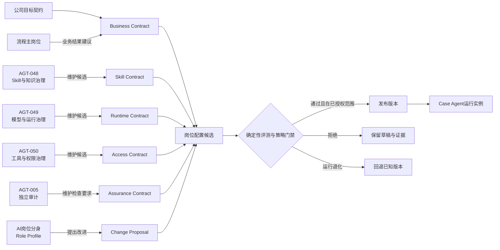

# 50个AI岗位的五契约管理图

状态：D-022与ADR-0004已确认。结构化数据见[agent-management-graph.json](agent-management-graph.json)。本图定义岗位配置的管理责任，不授予任何AI岗位发布、凭据、工具或业务资产权限。

## 核心关系

没有“上级Agent管理下级Agent”。AI岗位和治理岗位都只能产生带证据的Change Proposal或候选契约；确定性门禁依据已发布规则决定发布、拒绝或回退。公司目标、资产权限和控制标准不能由Agent自行修改。

## 五份管理契约

| 契约 | 必要内容 | 候选维护责任 | 不能包含或替代 |
| --- | --- | --- | --- |
| Business Contract | 使命、主岗位人格、目标来源、KPI、标准产物、业务范围、冲突取舍 | AGT-001与相应流程主岗位提出；公司目标契约提供上位约束 | 模型参数、Prompt全文、工具凭据 |
| Skill Contract | Skill名称/描述、正文引用、Playbook、知识来源、产物schema、工具依赖、评估案例、Memory Policy引用 | AGT-048 | 长期Agent身份、业务授权 |
| Runtime Contract | Model Profile、effort、上下文顺序、缓存、超时、成本、SLO、并发、失败与回退 | AGT-049 | 经营目标、业务资产权限 |
| Access Contract | 数据范围、可见Tools、Action Intent类别、Policy引用、有效期、撤权和审计要求 | AGT-050提出；模型外Case Control、Policy Gate与Execution Broker执行 | Service Identity凭据、用工具描述代替服务端校验 |
| Assurance Contract | Eval Suite、通过阈值、利益冲突、独立复核、发布门槛、观察窗口、回退证据 | AGT-005及适用控制岗位提出；确定性发布门禁执行 | 自测即发布、普通LLM最终批准 |

## 每个岗位的统一管理规则

1. 每个Role Profile必须同时引用五类契约；缺任一契约时不能形成可运行发布版本。
2. Business和Skill契约按岗位定义；Runtime、Access与Assurance可以在范围完全一致时共享模板，但每个岗位必须保存解析后的有效版本引用。
3. 修改任一契约都产生新候选版本，不覆盖已运行版本；历史Case继续引用启动时的版本集合。
4. 岗位本人、AGT-048、AGT-049、AGT-050和AGT-005均没有直接发布权。它们只能提出变更、证据、否决或恢复条件。
5. 低风险变更只有在现有公司目标、Access上限和Assurance门槛内才能自动发布。改变目标、扩大资产权限、降低门槛或修改独立性约束时，保持草稿并等待新的公司级契约。
6. 当前50个岗位的`production_authorized`均为false；五契约图是管理设计，不是DeepSeek Harness配置或生产状态。

## 管理责任不形成循环授权

| 特殊岗位 | 可以做 | 不能做 |
| --- | --- | --- |
| AGT-001 | 提出目标分解和Business Contract变更 | 修改公司目标来源或直接发布自身Business Contract |
| AGT-005 | 提出Assurance规则、检查证据、否决不合格候选 | 降低自身审计门槛或发布自身配置 |
| AGT-048 | 整理Skill、Playbook、知识与Memory Policy候选 | 发布自身Skill或跳过评测 |
| AGT-049 | 比较模型、上下文、缓存、成本、SLO与回退候选 | 以低成本为理由降低Business或Access约束 |
| AGT-050 | 提出数据、Tool、Identity和Policy边界，发起撤权 | 持有业务凭据、给自身或其他Agent最终授权 |

治理岗位自身仍使用同一套五契约和独立门禁。确定性系统只执行已发布规则，不产生经营目标或自行放宽权限。

## Site应展示的管理视图

点击任一岗位后，管理页至少展示：当前五份契约及版本、来源、候选变更、评测状态、授权状态、运行范围、最近回退和生产授权。默认隐藏Prompt正文、凭据、个人数据和不必要的内部实现信息。

五份契约按D-023绑定为不可变Role Release Bundle，完整状态和转换见[岗位Bundle与生命周期](AGENT-LIFECYCLE.md)。
