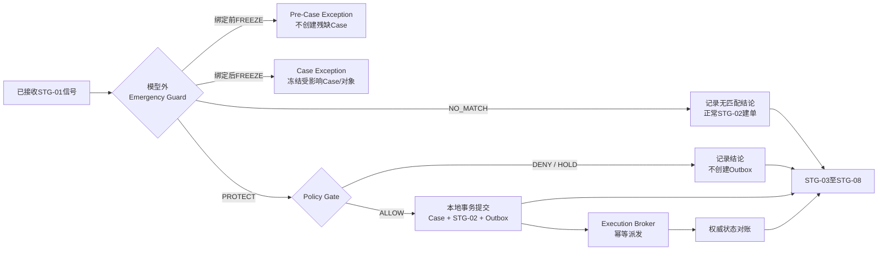

# 独立岗位Preset与受控组队运行模型

状态：D-020至D-029与D-053已确认逻辑岗位、独立岗位Preset、Lead/Worker受控组队、五契约Bundle生命周期、八阶段协同协议、Case唯一主价值流/主场景规则、Action Intent与Policy/Execution分离边界、以及FLOW-07模型外确定性紧急保护。本文是v2.3业务运行设计，不是Harness配置或生产授权；结构化阶段、流程、场景和岗位贡献关系见[协同图谱](COLLABORATION-GRAPH.md)。

## 已决定的运行原则

- 50个岗位各自拥有可独立寻址的Role Preset；岗位类型、能力包、运行实例和并发任务分别计量。
- 独立任务使用`standalone_role_preset`；复杂Case由Case Control选择一个Lead并按需装配`bounded_role_worker`，Lead持有Case结果责任。
- Case Control依据已发布规则绑定一个主价值流和一个主场景，固定Lead/Worker的Bundle、阶段、输入和输出；AGT-002提供制度、分诊与异常协调能力，不充当LLM自由路由器。
- Worker只消费已验收Stage Artifact并返回ArtifactEnvelope；岗位之间不共享隐式会话、不转授权限、不通过自由聊天决定资产动作。
- 每个阶段形成版本化产物和Acceptance Record；岗位通过Skills、产物规范和保障规则贡献能力。
- 初始运行不把真人负责人或HITL设为常规步骤。需要外部身份、资质或实物工作的步骤通过受控执行主体取得真实回执。
- 工具UI/UX可以成为工作入口；Case/Event Ledger、业务系统、Policy和外部回执保存权威状态。
- FLOW-07命中已发布确定性规则时，模型外Emergency Guard可在诊断前提交固定保护Intent；它不成为第二个Agent、不持有Service Identity，也不完成或跳过任何Case阶段。

## 第一性原理

一个经营闭环需要明确范围、可接收产物、模型外资产控制和可核对结果。独立岗位通过自己的Preset闭环；复杂协同通过Lead/Worker的ArtifactEnvelope推进，不通过部门群聊或隐式岗位Agent互聊推进。

~~~mermaid
flowchart LR
  S[信号] --> W[范围与Case]
  W --> C[上下文 主岗位 + Bundle + Skills]
  C --> E[证据与诊断]
  E --> D[方案产物]
  D --> A{Assurance Gate}
  A -->|接受| I[Action Intent]
  I --> P{Policy Gate}
  P -->|允许| X[Execution Broker]
  P -->|拒绝| R[返工或NoAction]
  X --> Q[回执与结果核验]
  Q --> K[Case关闭 异步学习候选]
  X -->|回执不明| F[冻结Case 查询外部状态]
~~~

## Case创建与装配契约

Case Control不按部门名派工，也不把50个岗位全部放入上下文。每次建单和装配必须留下下列记录：

| 判断输入 | 最低要求 | 正式产物 |
| --- | --- | --- |
| 信号 | 来源、时间、去重键和初步业务对象 | Signal Envelope |
| 业务范围 | 目标、品牌/市场/账号/商品、时间窗、唯一主价值流、唯一主场景、去重键及其规则引用/版本、自有资源预留引用集合和完成条件 | Case Charter |
| 组队角色 | STG-03依据已接收的Case Charter选择一个Lead及零个或多个Worker，记录每个角色的阶段责任和装配依据 | Context Manifest中的`lead_role_ref`与`worker_role_refs` |
| Bundle | STG-03固定五契约确定版本、Hash和生命周期状态 | Context Manifest中的`role_release_bundle_ref` |
| 能力 | 当前阶段需要的Skill描述、产物schema和保障规则 | Context Manifest |
| 数据与工具 | 权威来源、质量、可访问范围、工具scope和回执能力 | Context Manifest中的允许清单 |
| 运行冲突 | 同对象预算、库存、账号、队列与已有异常 | 预留、等待或冻结记录 |

D-025规定一张Case只选一条主价值流和一个主场景；一个信号需要多个价值流时创建共享`correlation_id`、相互引用但状态独立的Case。相关Case只引用已验收Stage Artifact，分别拥有目标、主岗位、Bundle、资源、异常和关闭结果。角色参与一条流程可表现为独立Preset或受控Worker；任何参与都必须有自己的Bundle、Access范围和产物责任，不产生隐式会话或权限。

## 独立岗位与组队装配

| 装配 | 适用任务 | 结果责任 | 最低交接 |
| --- | --- | --- | --- |
| `standalone_role_preset` | 单岗位诊断、分析、计划、复核或回执查询 | 该岗位对岗位产物负责 | 任务合同 + ArtifactEnvelope |
| `lead_case_preset` | 需要多个专业角色的一张复杂Case | Lead对Case整体结果负责 | Case Charter + 固定Bundle |
| `bounded_role_worker` | Lead指定的阶段增量任务 | Worker对增量产物、证据和异常负责 | 已验收Stage Artifact → ArtifactEnvelope |

Case Control必须在运行前写入角色装配清单；Worker不能自行增加角色、Skill、工具、范围或权限。需要新的专业能力时，返回缺口并由Case Control重新装配。

## FLOW-07紧急保护双通道

正常通道始终按STG-01至STG-08顺序运行。紧急通道只在已接收的FLOW-07权威信号命中一条已发布互斥规则时启动，并嵌在STG-02建单事务中：

`NO_MATCH`只记录不含规则、Case或动作引用的Guard Decision，然后继续正常STG-02。在主价值流、主场景或范围不能唯一绑定时，Guard只写入`Pre-Case Exception`并冻结受影响信号范围，不创建Guard Decision、残缺Case、Intent、Policy或Outbox。本地事务提交结果不明时同样先用Pre-Case Exception并查询账本；只有证明Case已提交，后续异常才使用`Case Exception`。本地原子性只覆盖Case/Event Ledger中的Case、STG-02 Charter/Acceptance、Guard Decision、固定Action Intent、Policy Decision和ALLOW时的Emergency Execution Outbox。外部系统副作用在事务提交后发生，必须通过幂等键、Execution Attempt和权威回执核对。

紧急通道只允许固定、最小、限制性且可逆的暴露控制；TTL仅限制首次派发，不自动恢复业务。紧急Attempt不是STG-07产物。重新开放、恢复曝光、扩大范围、对外承诺、退款、召回、销毁和永久变更仍须在正常STG-07经过方案、Assurance、Policy Gate与Execution Broker。具体信号、阈值、规则、模板、系统和Service Identity均未配置。

## 八条流程的默认主岗位与能力

下表中的负责人是默认Lead岗位；渠道、单一客诉和账号事件按已记录规则选择其他Lead。其他岗位可以独立执行自己的任务，也可以作为Worker通过ArtifactEnvelope贡献阶段产物；不会把全部50个岗位塞入同一个上下文。

| 流程 | 默认AI结果负责人 | 典型按需能力 | 主要结果 |
| --- | --- | --- | --- |
| FLOW-01 存量GMV | AGT-021 | 经营分析、渠道、库存、价格/广告、财务约束、增量评估 | 可执行且可复核的联合行动包 |
| FLOW-02 新品验证 | AGT-008 | VOC、机会、产品定义、工程/供应、合规、验证 | 继续、转向或停止的证据包 |
| FLOW-03 供需履约 | AGT-016 | 预测、库存、采购、物流、财务约束 | 供应计划与到货/可售核对 |
| FLOW-04 新市场渠道 | AGT-024 | 机会、产品/规则、本地化、履约、品牌 | 进入包与上线回执 |
| FLOW-05 客户旅程 | AGT-034 | 服务、体验、CRM、合规、复购评估 | 问题解决与复购证据 |
| FLOW-06 数据与工具 | AGT-047 | 编排、口径、数据质量、工具、可靠性、安全 | 可复用数据产品或工具闭环 |
| FLOW-07 重大事件 | AGT-018 | 质量、账号、服务、法务/合规、运行安全 | 范围受控、处置与恢复证据 |
| FLOW-08 经营与能力复盘 | AGT-001 | 分析、财务、审计、组织、知识与运行 | 资源、能力和策略版本建议 |

完整岗位贡献、场景入口、八阶段和异常关系见[协同图谱](COLLABORATION-GRAPH.md)和[结构化数据](collaboration-graph.json)。

## 工具是Agent的手和脚

工具分为六类，且同一工具可只对特定角色、范围和场景可见：

| 工具类别 | 作用 | 不能替代 |
| --- | --- | --- |
| 事实读取 | 获取订单、广告、库存、商品、客户、结算和规则事实 | 指标口径与数据质量判断 |
| 确定性校验 | 检查范围、映射、预算、幂等、状态和权限 | 经营判断与异常解释 |
| 业务写入 | 在策略允许范围内发起价格、内容、库存、工单等动作 | 回执核对与补偿 |
| 外部协作 | 向受控供应商、履约、专业服务或企业流程发起请求 | 法定身份、专业资格或实物工作 |
| 回执与恢复 | 查询外部效果、重试、补偿、冻结和恢复 | 直接把超时视为失败或成功 |
| 工具工作界面 | 呈现调用、证据、结果、异常和下一步 | 服务端权限、权威业务记录 |

在本机Harness资料中，ctx.tools.restrict可缩小Agent可见工具范围，ctx.tools.guard可单调拒绝调用；工具可提供presentCall和presentResult供Host侧展示，MCP工具可注册为mcp__server__tool。这些是本机文档已核实的能力方向，目标企业环境仍须按版本和实际schema验证，详见[平台落实方案](../10-platform/deepseek-harness/IMPLEMENTATION-PLAN.md)。

## 工具优先UI/UX

不再把独立业务看板设为唯一入口。工具调用与结果应形成工作卡：工单范围、调用目的、输入摘要、动作策略、外部回执、异常状态和下一步。管理层只需看到需要改变策略、扩大范围或恢复异常的业务事实。

工具卡只展示并解释，不授予权限；“显示成功”也不等于外部业务已成功。权威状态仍来自场景工单、动作策略和外部回执。

## 自治异常：候选基线

以下是待R04-Q3确认的推荐基线，尚非已发布生产策略：

| 情况 | 推荐自治反应 | 不允许的反应 |
| --- | --- | --- |
| 无适用动作策略 | 冻结受影响对象，记录缺口，继续处理不依赖该动作的部分 | 以通用提示词补写权限 |
| 工具拒绝或跨范围 | 保留拒绝证据，重新匹配范围或工具 | 换身份、换会话或改参数绕过 |
| 回执不明 | 先查询外部状态；按幂等键决定重试、补偿或冻结 | 整张工单重跑 |
| 数据过期或冲突 | 标记质量状态，切换可用的权威来源或暂停决策 | 把缺失值当作零 |
| 独立复核否决 | 返工、缩小范围或冻结动作 | 发起者用新工单绕过否决 |
| 外部执行主体未响应 | 记录等待与时效，隔离只依赖该主体的范围 | 将未响应标为完成 |

## 后置HITL与外部执行

后置HITL表示真人不会成为初始工单的默认分派、审批或接管节点；它不消除企业系统、供应商、专业服务和法定签署的现实约束。需要实物、资质或外部身份的步骤，只能通过受控的外部执行主体/系统取得实际回执。

当前没有任何MCP、API、hook、服务身份、业务动作或工具UI被配置到企业生产环境。连接资产与优先级见[系统接入盘点](../10-platform/deepseek-harness/SYSTEM-INTEGRATION-INVENTORY.md)。
