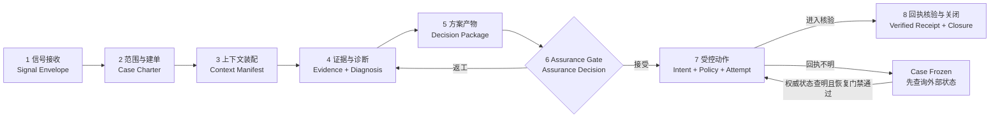

# 单Case Agent八阶段协同图谱

状态：D-024与[ADR-0006](../adr/0006-artifact-gated-eight-stage-collaboration.md)已确认统一协议；D-025与[ADR-0007](../adr/0007-one-flow-one-scenario-per-case.md)已确认Case唯一主价值流/主场景及关联Case规则；D-026与[ADR-0008](../adr/0008-deterministic-emergency-protection-guard.md)已确认FLOW-07模型外确定性紧急保护通道。全部8条价值流和当前20个候选业务场景使用同一逻辑协议；结构化图谱见[collaboration-graph.json](collaboration-graph.json)。当前没有Case、Guard规则、Outbox、工具连接或生产动作由本图谱实例化。

## 协同的第一性原理

协同的最小单位不是两个岗位Agent互发消息，而是一个Stage Artifact被下一阶段按Acceptance Gate正式接收。每张Case只有一个上下文所有者；到STG-03时固定一个主岗位人格和一个Role Release Bundle。其他岗位提供按需Skill、产物schema、判断规则或Assurance要求。

相邻逻辑阶段可以在同一次模型回合或工具事务中完成，但每个阶段的产物和Stage Acceptance Record必须分别落入Case/Event Ledger。无需外部动作的Case也经过第7阶段，形成`NoActionRecord`。

## 八个阶段

| 阶段 | 控制或执行主体 | 正式产物 | 最低接收条件 |
| --- | --- | --- | --- |
| STG-01 信号接收 | Case Control、system-of-record | Signal Envelope | 触发ID、来源、发生/接收时间、去重键和数据分类可追踪；范围提示可选 |
| STG-02 范围确定与建单 | Case Control、Case/Event Ledger | Case Charter | 恰好一个主价值流和一个主场景，组合符合已发布兼容关系；去重键及其规则引用/版本、业务范围、目标、约束与完成条件明确 |
| STG-03 上下文装配 | Case Control、Skill Registry | Context Manifest | 只选择一个主岗位人格并固定Bundle；Skills和Tools不超出五契约；不向模型暴露凭据 |
| STG-04 证据与诊断 | Case Agent、只读事实工具 | Evidence Pack、Diagnosis Record | 来源、版本、新鲜度、冲突、缺口、推断和不确定性明确 |
| STG-05 方案与标准产物 | Case Agent按需加载Skills | Decision Package | 符合流程产物schema，包含目标、约束、范围、预期结果和停止条件 |
| STG-06 Assurance门禁 | 确定性Assurance Gate；必要时只读Evaluator Delegate | Assurance Decision | 硬校验通过；语义问题已解决；Evaluator不能扩权或批准资产动作 |
| STG-07 受控动作 | Case Agent、Policy Gate、Execution Broker | Action Intent、Policy Decision、Execution Attempt或NoActionRecord | 每个Intent有策略结论；仅ALLOW可产生执行尝试；模型不持有Service Identity |
| STG-08 结果核验与关闭 | Case Agent、Case Control、Case/Event Ledger | Verified Execution Receipt、Case Closure | 外部状态、经营结果、约束、异常和成本完成核对；关闭后异步触发学习提取 |

每个阶段另有一份`Stage Acceptance Record`控制状态转换；STG-06的`Assurance Decision`是其业务输入之一。两者都不是资产授权。`Policy Decision`决定Action Intent是否可执行，Execution Broker才持有Service Identity并调用目标系统。

D-026的Emergency Guard是FLOW-07在已接收STG-01信号后的模型外保护电路，不是第九阶段。它在STG-02建单事务中生成独立控制记录；紧急Action Intent、Policy Decision、Outbox和Attempt不充当STG-07 Stage Artifact，也不改变顺序推进规则。

## 岗位如何参与同一Case

| 参与方式 | 运行含义 | 边界 |
| --- | --- | --- |
| 主岗位人格 | 从所选价值流和业务范围确定唯一AI结果负责人 | 一张Case只能有一个，不因加载Skill叠加人格 |
| Skill贡献 | 其他岗位把方法、步骤、知识和产物规范贡献给同一个Case Agent | Skill不成为独立岗位Agent，不获得额外权限 |
| 保障贡献 | 独立控制岗位提供Assurance Contract、Eval和审计标准 | 硬门禁在模型外执行，发起者不能覆盖拒绝 |
| Delegate | 处理窄范围、只读、自包含的语义评估或分析 | 输入最小且不可变；无完整会话、写入、再委派和状态修改能力 |
| 外部执行 | Policy Gate通过后由Execution Broker执行 | 模型不持有凭据或直接资产权限 |

图谱中不存在岗位到岗位的运行通信边。角色边只表示某岗位可以为一条价值流贡献人格、Skill、产物或保障规则。

## 八条价值流绑定

| 价值流 | 主岗位选择 | Playbook | 闭环产物 |
| --- | --- | --- | --- |
| FLOW-01 存量GMV | Amazon默认AGT-021；独立站AGT-023；其他平台AGT-024；B2B/零售AGT-025 | PB-001 | 联合经营行动包及效果回执 |
| FLOW-02 新品验证 | AGT-008 | PB-002 | 继续、转向或停止的证据包 |
| FLOW-03 供需履约 | AGT-016 | PB-003 | 供应计划、到货与可售核对 |
| FLOW-04 市场进入 | AGT-024 | PB-004 | 市场进入包、上架与初步经营结果 |
| FLOW-05 客户旅程 | 生命周期经营默认AGT-034；单一客诉AGT-037 | PB-005 | 问题解决、补救与复购证据 |
| FLOW-06 数据与工具 | AGT-047 | PB-006 | 数据契约或工具能力闭环 |
| FLOW-07 重大事件 | 质量事件AGT-018；账号事件AGT-027 | PB-007 | 范围、处置、根因与恢复证据 |
| FLOW-08 经营复盘 | AGT-001 | PB-008 | 资源、策略和能力版本建议或结果 |

FLOW-02、03、04、06和08已有单一默认主岗位。FLOW-01、05和07只有自然语言分类条件，尚未形成可执行、互斥且有优先级的selector；零匹配或多匹配时必须进入Waiting，不能由模型自由猜测。现有140条岗位-价值流关系仅保留历史职责覆盖，仍需转换为具体Skill Contract、产物schema和Assurance规则。

每条价值流均显式引用八个逻辑阶段，共形成64条flow-stage绑定。现有Playbook足以描述各阶段的业务意图，但Skill版本、输出schema、Assurance Profile、Policy Profile和异常阈值均保持未实例化状态。

**D-025已确认的绑定规则**：一张Case只选择一条主价值流和一个主场景，并以`case_dedupe_key`阻止同一信号、主价值流、主场景、业务范围和规则版本重复建单；Case同时保留`case_dedupe_rule_ref`和`case_dedupe_rule_version`以便重算。其他场景仅作相关引用。同一事件触发多个价值流时，创建共享`correlation_id`但状态独立的Case。每张Case分别拥有目标、完成条件、主岗位、固定Bundle、资源预留、异常和关闭结果；`resource_reservation_refs`是每张Case自有且可为空的集合，关联Case不能共用同一预留记录，预留本身不授予资产权限。跨Case只能通过`REC-CROSS-CASE-ARTIFACT-REF`只读引用来源Case已经验收的Stage Artifact，并核对来源Case、Artifact ID、产物版本、Hash和实际接收该Artifact的ACCEPT记录。

## 20个场景的价值流入口

场景是尚待业务访谈验证的问题分类，一项场景可能兼容不同价值流。下列51项只表示候选兼容关系，不表示运行时已能自动选路；每张Case仍必须从中确定一个主场景和一个主价值流。其中18个场景有多个候选价值流，所需selector规则尚未发布。

| 场景 | 可选价值流 | 场景 | 可选价值流 |
| --- | --- | --- | --- |
| SCN-001 | FLOW-01、06、08 | SCN-011 | FLOW-01 |
| SCN-002 | FLOW-02、04、05 | SCN-012 | FLOW-02、04、05 |
| SCN-003 | FLOW-02、08 | SCN-013 | FLOW-01、02、05 |
| SCN-004 | FLOW-02、07 | SCN-014 | FLOW-03、04、05、07 |
| SCN-005 | FLOW-02、04、07 | SCN-015 | FLOW-05、07 |
| SCN-006 | FLOW-02、03、07 | SCN-016 | FLOW-01、03、05、06、08 |
| SCN-007 | FLOW-01、03 | SCN-017 | FLOW-03、08 |
| SCN-008 | FLOW-03、04 | SCN-018 | FLOW-01、04、07 |
| SCN-009 | FLOW-01、02、04 | SCN-019 | FLOW-08 |
| SCN-010 | FLOW-01、03 | SCN-020 | FLOW-06、08 |

## 异常、返工与隔离

| 触发 | Case状态 | 恢复条件 |
| --- | --- | --- |
| 输入缺失、过期或依赖不可用 | Waiting | 在同一阶段重新核对依赖和新鲜度后继续 |
| 产物或Assurance被拒绝 | Rework Required | 返回明确阶段并创建新产物版本，旧版本保留 |
| Policy Gate拒绝动作 | Rework Required或以NoAction关闭 | 返回STG-05缩小/改变方案，不能绕过原拒绝 |
| 外部执行回执不明 | Frozen | 按幂等键查询外部状态后再决定重试、补偿或关闭 |
| 并发Case争用预算、库存、账号或对象 | Waiting或Frozen | 确定性预留和优先级规则解决冲突 |
| 固定Bundle进入Quarantined | Frozen | 按岗位生命周期进行受控迁移、回退或新建Case；禁止新动作 |

Waiting、Rework Required和Frozen是Case状态；Quarantined是Role Release Bundle状态。冻结尽量限制到受影响Case和业务对象，不能通过换会话、换主岗位或重跑整单绕过。

每次Waiting、Rework Required或Frozen都必须形成`REC-CASE-EXCEPTION`，记录受影响范围、触发证据和恢复门禁。执行状态不明时还要绑定原Execution Attempt与幂等键；在权威系统查询结果落账且恢复门禁通过前，STG-07禁止产生新动作或重放原动作。

## FLOW-07模型外紧急保护边界

D-026采用正常八阶段与确定性保护双通道。只有下列条件全部成立，Emergency Guard才能形成`PROTECT`：已接收的权威机器信号、唯一已发布且未过期的互斥规则、规则固定的FLOW-07兼容主场景与Case Charter、唯一保护模板、最小业务范围、Policy版本、首次派发TTL、幂等算法和最大影响边界。模型不能参与选参、改变模板或扩大范围。

本地事务提交Case、STG-02 Attempt/Case Charter/Acceptance、`REC-EMERGENCY-GUARD-DECISION`、固定`REC-ACTION-INTENT`、`REC-POLICY-DECISION`和Policy为ALLOW时的`REC-EMERGENCY-EXECUTION-OUTBOX`。Outbox在事务提交前对Broker不可见；外部系统副作用不属于本地事务，Execution Broker在提交后按幂等键派发并生成Attempt，权威状态可用时立即对账。

`NO_MATCH`只生成不含规则、Case、范围或动作引用的`REC-EMERGENCY-GUARD-DECISION`，不生成紧急Intent、Policy或Outbox，信号继续正常处理。若规则、主场景或范围在合法Case绑定前不唯一，`FREEZE`只生成`REC-PRE-CASE-EXCEPTION`并冻结受影响信号范围，不创建Guard Decision、残缺Case、Intent、Policy、Outbox或Attempt。本地事务结果不明时也先记录Pre-Case Exception并按`atomic_commit_ref`查询；证明Case已提交后，模板、执行或回执状态不明才生成`REC-CASE-EXCEPTION`并冻结受影响Case/对象。Policy正常返回DENY或HOLD不生成Outbox，由已发布Case处置规则决定继续、等待或冻结。

紧急通道只允许固定、限制性、可逆且只降低暴露的动作。TTL只控制首次派发，不能自动恢复。恢复、重新开放、扩大范围、外部声明或承诺、退款、召回、销毁和永久变更只可在正常STG-07执行；STG-08必须同时核对紧急与正常动作的权威回执。具体规则、阈值、模板、Service Identity和生产范围尚未发布。

## 静态图与运行记录分离

本文件和[结构化协同图](collaboration-graph.json)保存阶段、价值流、场景候选关系、岗位能力来源与Emergency Guard控制边。运行中的Case、阶段尝试、产物、门禁、动作和回执使用独立的[Case Record契约](case-record-contract.json)。当前该契约没有实例；D-025只确认绑定基数，D-026只确认紧急保护架构，两者都不验证51条候选兼容关系或发布具体动作规则。

## Site展示规则

Site默认显示价值流、Case阶段和正式产物。用户选择一条价值流、场景或岗位后，才展开对应能力贡献边；不会同时绘制全部关系。

所有协同视图固定显示：当前设计版本、是否存在运行Case、Bundle状态、阶段Acceptance结果以及`production_authorized`。图谱边不能被渲染成行政上下级、岗位Agent消息或数据/工具授权。
