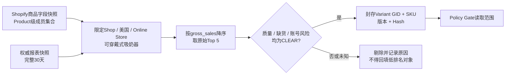

# BVS-01 Shopify首批Variant/SKU范围清单契约

状态：`Target-state Contract / HOLD_NO_PUBLISHED_PRODUCTS`。D-050确认目标Shopify无上线商品，因此当前没有可排名的Variant/SKU、30天报告或Top 5；缺失行不得解释为零。D-038至D-049的生成、报表、产品家族、Scope、Level 1和45天保留规则全部保留，待`SHOP-G6/SHOP-G7`后执行。本文不包含真实SKU、Shop标识、销售明细、客户信息或凭据，也不授权报表读取、Protected Customer Data访问、Metafield Definition创建、字段回填、商品修改、App创建、API调用或业务写入。

机器可检验字段见[结构化清单](bvs-01-shopify-sku-scope-manifest.json)。

## 1. 清单承担什么

该清单是BVS-01一张FLOW-01 Case的商品范围边界。Case、Policy Gate和`shopify_channel_read`都必须引用同一个`manifest_id + version + content_hash`；未封存、已过期或Hash不匹配的清单不能进入Shadow。

## 2. 确定性生成规则

1. **冻结来源**：从目标商店`Analytics > Reports > Total sales by product variant`导出CSV，保存目标Shop中的报告引用、Shop非敏感别名、报表配置、实际导出选项标签、提取时间、原始文件SHA-256、Schema Hash、行数、币种、时区和生成者引用；不把原始销售文件放入本仓库。目标Shop中找不到该报告、字段不满足或只能证明页面/分页子集时停止。
2. **冻结窗口**：使用目标Shop本地时区中最近30个完整自然日，排除提取当日未结束的数据；记录闭区间起止时间。
3. **限定候选集**：从同一目标Shop的Product级`custom.product_family`快照产生成员集合；只有原始存储值精确等于`wearable_breast_pump`的Product才是成员，所属Variants继承后再与美国Market、Online Store及销售报告行求交集。运行时不做大小写、空白或同义词修复。首次种子覆盖验收通过前，缺值按成员歧义HOLD；验收通过后，缺值或其他已发布合法值才解释为非成员。销售导出必须至少包含`Product title`、`Variant title`、`Variant SKU`、`Gross sales`和`Net quantity`；若导出没有稳定`variant_gid`，必须再用经核验的商品快照把SKU唯一映射到`variant_gid + sku`。空SKU、重复SKU、映射一对多、Definition冲突、非法值或仅靠Product type、tag、标题/模型语义猜测的对象退出候选集并HOLD。
4. **计算排名**：按D-035的`gross_sales`定义聚合到Variant；按`gross_sales DESC`、`net_quantity DESC`、`variant_gid ASC`稳定排序。币种或时间口径不一致时不得排名。
5. **截取Top 5**：先固定原始排名前5，不因后续风险剔除而从第6名以后回填。
6. **执行三类风险门**：质量、缺货和账号风险必须分别取得权威状态与证据引用。只有三类均为`CLEAR`的Variant可进入最终清单；`BLOCKED`或`UNKNOWN`均被剔除。
7. **检查数量**：最终保留3–5个Variant时可进入封存；少于3个时结果为`HOLD_INSUFFICIENT_ELIGIBLE_VARIANTS`，不得放宽产品族、Market、时间窗或风险规则补数。
8. **封存清单**：AGT-050验证访问边界后生成不可变版本和内容Hash；任何成员、窗口、来源、风险证据或规则变化都创建新版本，运行中的Case不自动跟随。

“高GMV”只决定候选排名，不覆盖风险门。风险剔除结果不重写原始Top 5，也不把低排名对象伪装成原始Top 5。

### 2.1 D-041至D-044产品家族成员快照

Definition契约固定为名称`Product family`、namespace/key=`custom.product_family`、`ownerType=PRODUCT`、类型`single_line_text_field`，初始预设选项包含`wearable_breast_pump`。成员规则固定为原始规范值`EXACT_EQUALS wearable_breast_pump`，写入前使用受控snake_case值，运行时禁止自动规范化。初始只要求获批App经Admin GraphQL读取；Storefront与Customer Account访问关闭。Product type、product tag及其他metafield不能作为静默回退。

目标Shop实例仍必须记录Definition ID、实际访问设置、创建/读回时间、定义版本与Hash。若已存在同名但owner type、类型、校验或访问设置不兼容的Definition，必须HOLD，不自动覆盖或迁移。Definition创建、Product值回填及批量修正均是写入动作，只有获得对应授权后才能通过模型外执行路径完成。

Product GID是成员判定主键；Variant GID和SKU只用于继承及与销售报表关联。不得以产品标题、描述、图片、模型推断或销售表现替代已确认选择器。首次种子固定为一次性负责人确认的Product GID清单，清单只负责初始化；覆盖验收通过后，`custom.product_family`接管持续权威，清单保留为不可变审计证据。

种子清单必须绑定同一目标Shop和同一时点的全量Product目录快照，记录清单版本/Hash、目录快照引用/Hash、目录商品数、清单商品数、负责人确认引用与时间，以及每行唯一`product_gid + expected_value`。原始清单保存在企业批准的受控存储；仓库与Site只保存脱敏引用和Hash。覆盖验收必须同时满足：Definition实例兼容；负责人确认清单对绑定目录快照完整；清单GID解析率100%；重复GID为0；跨Shop GID为0；获批回填后`wearable_breast_pump`精确值读回率100%；覆盖快照可重放。任一条件未满足，或Definition实例未验证、字段缺失/非法、快照不可重放、Product→Variant→SKU映射不唯一时，进入`HOLD_PRODUCT_FAMILY_MEMBERSHIP_AMBIGUOUS`，不进入Top 5排名。

### 2.2 D-045至D-049只读预检、Scope与订单数据边界

只读预检依次生成并封存六类证据：目标Shop/App身份与实际Scopes读回；`custom.product_family`同名Definition冲突审计；全量Product目录快照；负责人确认的Product GID清单对账；官方`Total sales by product variant`报告字段、过滤器与完整导出能力核验；`READ_ONLY_PREFLIGHT_EVIDENCE_PACK`版本与Hash。原始目录和报告数据保存在企业批准的受控存储，仓库与Site只保留脱敏摘要、引用、计数和Hash。

Definition结果固定为三态：`ABSENT`只形成独立创建方案；`COMPATIBLE`复用现有Definition并只形成独立回填方案；`INCOMPATIBLE`进入`HOLD_PRODUCT_FAMILY_MEMBERSHIP_AMBIGUOUS`，不自动覆盖、迁移或改写。预检阶段不允许Definition创建、Product metafield写入、商品修改或App Scope扩张。后续写入方案必须引用预检包Hash并另行获得授权。

预检声明Scope包固定为`read_products`、`read_orders`、`read_inventory`、`read_locations`和`read_markets`；`read_all_orders`、`read_customers`、`read_reports`及全部`write_*`排除。Admin CSV导出与App API Scope分离。实际集合必须由`currentAppInstallation.accessScopes`读回并完全匹配，否则进入`HOLD_SCOPE_MISMATCH`。D-047只允许Level 1最小必要订单/行项目字段，直接身份、客户主档、自由文本、支付与员工字段拒绝；原始响应零持久化，模型只见SKU日聚合。D-048允许规范化行加密保存45天并要求期满24小时内硬删除；D-049要求先在目标Dev Dashboard只读确认App类型和同一Organization关系。Level 1现场证据、字段Schema与Query Hash、删除/访问/备份TTL控制完成前不发布任何订单Query模板。

## 3. 三类风险门

| 风险门 | 权威状态 | 最小证据 | 责任贡献 | 未满足时 |
| --- | --- | --- | --- | --- |
| 质量 | `CLEAR / BLOCKED / UNKNOWN` | QMS或正式质量准入记录、规则版本、有效期 | AGT-018 质守 | 剔除该Variant；`UNKNOWN`不得当作`CLEAR` |
| 缺货 | `CLEAR / BLOCKED / UNKNOWN` | ERP/WMS可承诺库存、在途映射、风险规则版本和观察时间 | AGT-017 衡仓 | 剔除该Variant；Shopify库存不能自动替代企业ATP |
| 账号 | `CLEAR / BLOCKED / UNKNOWN` | Shop/渠道账号健康、商品发布状态、Market可售状态和有效期 | AGT-027 守店 | 剔除该Variant；不得用GMV覆盖账号风险 |

三类权威系统和具体阈值仍待企业事实确认。清单只能引用已发布的风险判定结果，不允许Case Agent自行解释原始告警或补写`CLEAR`。

## 4. 必需字段

| 字段组 | 字段 | 验收要求 |
| --- | --- | --- |
| 身份 | `manifest_id`、`version`、`status`、`content_hash` | 版本唯一；封存后不可原地修改 |
| 范围 | `shop_ref`、`market_ref`、`sales_channel`、`product_family_ref` | 与BVS-01业务范围完全一致 |
| 产品家族成员 | Product GID、选择器类型/字段/值/算子、规则版本、快照Hash、所属Variant GID/SKU | Product层精确判定；Variant继承；禁止标题或模型推断 |
| 首次种子 | 清单版本/Hash、Shop引用、全量Product目录快照引用/Hash、负责人确认引用、唯一Product GID、期望值 | GID解析率与回填后精确值读回率均为100%；重复与跨Shop均为0；负责人确认清单完整 |
| 来源 | `report_source_ref`、`report_version`、`snapshot_hash`、`extracted_at` | 可追溯到一次不可变报表快照 |
| 窗口 | `shop_timezone`、`window_start`、`window_end`、`window_days` | 30个完整Shop本地自然日 |
| 口径 | `metric_id`、`currency`、`metric_rule_ref` | `metric_id=gross_sales`；币种明确 |
| 排名 | `variant_gid`、`sku`、`gross_sales`、`net_quantity`、`raw_rank` | 唯一映射且能按同一快照重算 |
| 风险 | 三类状态、证据引用、规则版本、观察时间、有效期 | 三类均`CLEAR`才能入选 |
| 结果 | `selected`、`exclusion_reasons`、`sealed_at` | 原始Top 5与最终清单同时保留 |

客户姓名、邮箱、电话、地址、订单号、订单备注、支付工具信息和员工身份不进入报表快照或清单。原始CSV保存在企业批准的受控对象存储中；本仓库、Site和Case只保存来源引用、配置摘要、Hash、行数和经脱敏的Top 5清单。

## 5. Shopify Admin Analytics导出快照契约

Shopify官方当前说明：`Total sales by product variant`报告以产品变体粒度拆分销售，包含`Variant SKU`与`Net quantity`，并呈现`gross sales`；Admin报告可以导出，页面仅展示最多1,000行时应使用导出来取得完整结果。目标商店的套餐、报告版本、实际字段和导出选项仍必须在导出现场验证，官方通用说明不能替代这一步。

| 快照项 | 必填内容 | 失败动作 |
| --- | --- | --- |
| 商店身份 | 非敏感`shop_alias`；与后续Shop GID核验记录相连 | 无法唯一定位目标Shop则HOLD |
| 报告身份 | 实际报告标题、稳定引用或保存探索ID、报告配置版本 | 只能靠截图或人工描述则HOLD |
| 范围配置 | 最近30个完整Shop本地自然日、美国Market、Online Store、产品族筛选及排序 | 任一筛选不可重现则HOLD |
| 字段 | `Product title`、`Variant title`、`Variant SKU`、`Gross sales`、`Net quantity`；币种和时区另有记录 | 缺少Variant/SKU粒度或`Gross sales`时不得改用产品级分摊、`net_sales`或`total_sales` |
| 导出回执 | 格式、导出选项、`exported_at`、原始文件SHA-256、Schema Hash、行数、生成者/服务身份引用 | Hash、Schema或行数为空则不能重算或封存 |
| 存储与隐私 | 原始CSV仅在批准的企业对象存储；仓库和Site不保存销售行或客户PII | 发现PII或文件进入错误存储则隔离快照 |

D-040已把Shopify官方`Total sales by product variant`报告的CSV导出固定为首份快照路径。它只有在目标Shop实测包含上述必需字段、能够导出当前配置下的全部合格行并能唯一完成商品主数据映射后，才可形成具体`report_source_ref`。如果失败，状态进入`HOLD_REPORT_CAPABILITY_MISMATCH`；自定义Analytics exploration和ShopifyQL都不自动接管，必须重新提出路径决定。Admin导出不增加试点App的`read_reports` Scope。

### 5.1 固定报告配方

| 配方项 | 固定值或规则 |
| --- | --- |
| 报告路径 | `Shopify Admin > Analytics > Reports > Total sales by product variant` |
| 报告类型 | Shopify默认报告；目标Shop中的实际标题、URL/ID或保存引用仍须观察记录 |
| 导出格式 | CSV |
| 窗口 | 目标Shop本地时区最近30个完整自然日，排除当前未完成日 |
| 必需维度 | `Product title`、`Variant title`、`Variant SKU` |
| 必需指标 | `Gross sales`、`Net quantity` |
| 排名 | `Gross sales DESC`，再按`Net quantity DESC`和完成映射后的`variant_gid ASC`稳定破同分 |
| 完整性 | 导出必须覆盖当前配置下全部合格行；只取得页面1,000行、当前分页或无法证明完整性时HOLD |
| 身份补全 | 报告不含稳定Variant GID时，以独立、同版本的商品主数据快照将SKU一一映射到Variant GID |
| 失败策略 | 缺字段、映射非唯一、币种/时区不明、过滤不可重现或导出不完整均进入`HOLD_REPORT_CAPABILITY_MISMATCH` |

导出器必须记录界面实际显示的导出选项文本，不能预设目标Shop一定存在名为“Full report”的按钮。无论界面标签如何，验收的是全部合格行、可重算配置与原始文件Hash。

## 6. 岗位分工与交接

| 步骤 | 主责 | 贡献与独立保障 | 交付与交接条件 |
| --- | --- | --- | --- |
| 提出范围需求 | AGT-023 自航 | AGT-003 明镜给出经营解释 | `Scope Request`明确Shop、Market、产品族、窗口和D-035口径 |
| 冻结报表与重算 | AGT-046 清源 | AGT-040 清账复核`gross_sales`分量 | `Report Snapshot`具来源、Hash、币种、时区且可重算 |
| 映射和排名 | AGT-045 同尺 | AGT-046检查唯一键与缺失 | `Ranked Top 5`包含稳定排序与排除前原始排名 |
| 风险门 | AGT-018、AGT-017、AGT-027分别贡献 | AGT-044检查数据最小化 | 每个Variant三类状态和证据齐全；发起者不能覆盖否决 |
| 封存与使用 | AGT-050 门卫 | AGT-049稳行记录版本/过期，Policy Gate执行范围拒绝 | 3–5个对象、版本和Hash封存；白名单外请求在外部调用前被拒绝 |

这些岗位通过Skills、Stage Artifact和确定性门禁贡献能力；不建立岗位Agent互聊。运行时仍只有一张Case、一个AGT-023主人格和一个Case Agent。

## 7. 状态与失败边界

- `DRAFT_READ_ONLY_PREFLIGHT_CONTRACT_CONFIRMED_EXECUTION_PENDING`：Definition、成员值、种子、报告路径与只读预检顺序已经确认；预检访问未授权或执行，目标Shop Definition实例、真实种子清单、字段回填/覆盖和报告能力尚未验证；当前状态。
- `HOLD_PRODUCT_FAMILY_MEMBERSHIP_AMBIGUOUS`：成员选择器未发布、字段缺失/冲突、快照不可重放或Product→Variant→SKU映射不唯一；不得进入排名。
- `HOLD_REPORT_CAPABILITY_MISMATCH`：报告不存在、缺少必需字段、无法证明完整导出、过滤不可重现或商品身份映射不唯一；不得自动切换自定义报告或ShopifyQL。
- `RANKED`：Top 5及重算证据完成，风险门尚未完成。
- `RISK_CHECKED`：三类风险结论完整，等待数量和访问复核。
- `SEALED`：3–5个Variant、版本、Hash及有效期固定，可供Shadow Case引用。
- `HOLD_INSUFFICIENT_ELIGIBLE_VARIANTS`：风险剔除后少于3个，停止并形成异常记录。
- `EXPIRED / SUPERSEDED`：窗口、证据或规则失效，禁止新Case引用；已有Case继续固定原版本或按Case冻结规则处置。

原始Top 5和最终入选集必须同时留存。没有风险证据、报表无法重算、对象映射不唯一、币种混合、窗口含不完整日、成员少于3个或Hash不一致时，均不得标记为`SEALED`。

## 8. 下一事实门

D-049已固定目标Dev Dashboard现场只读资格证据路径；D-050将其延期到`SHOP-G6`。未来另行授权、产品上线并达到`SHOP-G6`后，先按[现场证据包](../10-platform/deepseek-harness/SHOPIFY-LEVEL1-QUALIFICATION-EVIDENCE-PACK.md)核验App类型、Organization关系、生命周期和声明Scope。获得资格证据和独立访问授权后，才按顺序核验字段Schema/Query Hash、删除/访问/备份TTL控制、Definition三态、目录快照、真实种子清单和报告能力，封存预检证据包。Definition创建与字段回填继续另案授权。无需在对话或仓库中提供销售行、订单明细、客户信息或凭据。
