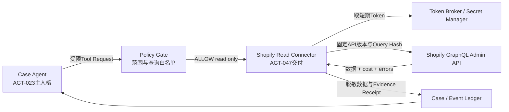

# Shopify试点专用只读连接器登记契约

状态：D-050后的目标状态设计契约，当前`HOLD_NO_PUBLISHED_PRODUCTS`。D-051限定当前只审阅方案；只读连接器延期到未来`SHOP-G6`。D-036至D-049的专用App、认证、SKU/报表、Product metafield/种子、Scope、Level 1与45天保留规则继续有效，但尚无Product/Variant/SKU、App、Scope、报表或调用实例。本文不是Shopify或DeepSeek Harness可直接导入的配置，不包含凭据或销售明细，也不授权App创建、目标Shop访问、Protected Customer Data访问、Metafield Definition创建、字段回填、外部连接或商品修改。

## 1. 连接器承担什么

该连接器只为BVS-01的Momcozy美国Shopify主站试点提供渠道事实读取。它不是新的岗位人格，也不是让AGT-023直接持有Shopify身份。

模型、Prompt、Skill、Site和Case Artifact均不得读取Client Secret或Access Token。App身份、短期Token获取、请求签名、重试和撤权由模型外连接器运行时负责。

## 2. 已确认与待实例化

| 项目 | 设计值 | 当前状态 |
| --- | --- | --- |
| 身份模式 | 新建BVS-01试点专用Dev Dashboard App | D-036已确认 |
| 连接范围 | 一个Momcozy美国主Shopify商店；目标态最终3–5个封存Variant | 当前无上线商品；Shop GID、永久域名与白名单成员均待`SHOP-G6/SHOP-G7`实例化 |
| 使用方式 | 服务端后台只读任务 | 已确认设计 |
| 认证 | `client_credentials` | D-037已确认同一Shopify Organization；实现尚未验证 |
| 备选认证 | 无 | `custom distribution`不在本试点路径中，不能自动回退 |
| 首份排名报表 | `Analytics > Reports > Total sales by product variant` CSV | D-040已确认路径；目标Shop能力与完整导出待验证，不自动回退其他报表 |
| 产品家族成员 | `custom.product_family`精确等于`wearable_breast_pump` | D-043已确认Definition契约，D-044已确认一次性Product GID种子契约；目标Shop实例、真实清单、字段覆盖与快照待确认 |
| API | GraphQL Admin API，运行时固定受支持版本 | 候选`2026-07`；真实响应版本待验证 |
| 声明Scope包 | `SHOPIFY_BVS01_READ_V1`：Products、Orders、Inventory、Locations、Markets五项读取 | D-046已确认设计；实际授权未读回 |
| 订单PCD契约 | `SHOPIFY_BVS01_ORDER_LEVEL1_V1`：Level 1最小必要、原始响应零持久化、规范化行45天加密保留、模型仅SKU日聚合 | D-047/D-048已确认字段与保留政策；资格及控制证据未完成，订单Query未启用 |
| Level 1资格证据 | 目标Dev Dashboard现场只读核验，9项脱敏证据 | D-049已确认路径；D-050延期到`SHOP-G6`，目标事实未观察 |
| 业务动作 | 无 | 所有`write_*`及mutation默认拒绝 |
| 运行状态 | Draft | 未创建、未安装、未连接、未进入Shadow |

选择专用App的目的，是把试点范围、Scopes、版本、撤权和审计与其他企业集成隔离。它不代表必须复制业务数据、建立第二套订单系统或允许模型直接调用Shopify。

## 3. 最小登记记录

App创建前必须形成一条版本化登记记录；未知项保持`pending`，不能用推测值填充。

| 字段组 | 必需字段 | 验收要求 |
| --- | --- | --- |
| 业务绑定 | `tenant_ref`、`brand_ref`、`market_ref`、`pilot_id`、`case_type` | 只允许BVS-01 / FLOW-01 / 美国 / 可穿戴式吸奶器试点 |
| App身份 | `app_alias`、非敏感`client_id_ref`、Dev Dashboard Organization引用、配置版本、环境 | App唯一且专用于试点；不保存Client Secret |
| Shop身份 | Shop GID、永久`myshopify.com`域名、主域名、币种、时区、Markets | App读回值与批准别名唯一匹配 |
| 认证 | grant/install模式、Token Broker引用、Secret Manager引用、Token TTL与刷新规则 | 模型不可见；撤权后停止；失败不回退到人工粘贴Token |
| 授权 | 声明Scopes、实际读回Scopes、Protected Customer Data状态、批准时间与版本 | 声明与实际逐项比对；多余Scope视为失败 |
| 数据边界 | Dataset、字段白名单、Variant/SKU白名单、30天窗口、币种与时间规则 | 请求发出前拒绝越界，不依赖返回后过滤 |
| 查询边界 | GraphQL operation名、规范化Query Hash、变量schema、成本上限、分页规则 | 首轮只允许query；未知Hash、mutation与Bulk任务拒绝 |
| 运行证据 | 请求ID、Case、Bundle、API版本、cost/throttle、游标、错误、脱敏shape hash、时间 | 每次调用可回放且不记录凭据/PII |
| 生命周期 | Draft、Evaluated、Shadow、Limited、Production、Quarantined、Retired | 复用岗位Bundle七状态语义；当前只允许Draft |
| 撤权恢复 | App禁用/卸载、Secret轮换、Scope缩减、Token失败与游标恢复 | 撤权立即停止新调用；恢复前重新做身份与Scope读回 |

结构化字段见[登记契约JSON](shopify-readonly-connector-registration.json)。

### 3.1 固定认证与安装顺序

1. 在已确认的Shopify Organization的Dev Dashboard创建用途唯一的BVS-01专用App；
2. 创建并发布仅含批准Scopes的配置版本，记录非敏感App别名、Client ID引用和版本引用；
3. 把该版本安装到唯一目标Shop，并读回Shop GID、永久域名、主域名、币种、时区和Markets；
4. 模型外Token Broker使用Client ID与Secret向目标Shop Token endpoint发起`client_credentials`交换，以响应的`expires_in`管理短期Access Token；
5. Connector使用短期Token读回`currentAppInstallation`与实际Scopes，和声明Scopes逐项比对；
6. 只有Shop身份唯一、Scope无缺失也无多余、PII与范围策略通过时，登记才可从Draft进入Shadow。

App未创建、配置版本未发布、未安装、Token交换失败、401/403、Shop身份不唯一或Scope不一致时，连接器保持Draft并冻结调用。不得把Client Secret或Token传给模型、Prompt、Skill、Case Artifact、UI或仓库，也不得用人工粘贴长期Token恢复。

## 4. Scope阶梯

D-046确认首轮声明Scope包`SHOPIFY_BVS01_READ_V1`：

- `read_products`
- `read_orders`
- `read_inventory`
- `read_locations`
- `read_markets`

以下Scope明确不在首轮声明包：

- `read_all_orders`：30天试点位于默认60天订单范围内，不申请；
- `read_customers`：不读取客户主档；
- `read_reports`：Admin Analytics CSV走独立受控导出，不启用ShopifyQL；
- `read_discounts`、`read_returns`、`read_shopify_payments_payouts`：未来确有缺口时另建Scope包版本并重新决策。

任何`write_*` Scope、Customer身份字段、支付工具明细、员工身份字段都不在本连接器范围。D-047将`read_orders`固定为Level 1最小必要数据面，D-048固定规范化行45天加密保留；声明Scope保留，但在Level 1资格、字段Schema/Query Hash和删除/访问/备份TTL测试完成前订单Query模板不发布。Scopes变更产生新登记版本并重新经过CVS-03验证，不能由Case Agent临时扩展。

### 3.1 `SHOPIFY_BVS01_ORDER_LEVEL1_V1`

订单模板只可查询：Order/LineItem GID，订单创建、更新、处理、取消、关闭时间与取消/财务/履约/测试状态，Product/Variant GID、SKU、初始与当前数量，以及`originalTotalSet`、`originalUnitPriceSet`、`discountedTotalSet`、`totalDiscountSet`、`priceAfterAllDiscountsBeforeTaxesSet`中的Shop/Presentment金额和币种。正式模板必须固定API版本、字段Schema Hash、Query Hash、变量Schema和30天Shop本地时间窗。

以下字段在Query与响应Shape中同时拒绝：Customer对象，姓名、地址、邮箱、电话、Locale、Journey、Marketing consent、IP、Cart/Checkout Token、订单备注、Custom attributes、Metafield、Tag、员工、支付网关/交易/收款工具、Gift Card、折扣码、状态URL、客户可见订单名/确认号和其他自由文本。Connector收到意外字段、GraphQL顶层/字段错误或疑似PCD资格脱敏`null`时整页fail closed，分别进入`HOLD_PROTECTED_CUSTOMER_DATA_SHAPE_MISMATCH`或`HOLD_PROTECTED_CUSTOMER_DATA_APPROVAL_MISMATCH`。

原始响应只在Connector内存中校验和聚合，持久化保留为0；模型、Case Agent和Tool UI只接收SKU日聚合、状态计数、来源版本与Evidence Receipt。规范化订单行只可在企业批准的隔离存储中加密保存45天，从Shop时区源业务日结束时起算，期满后24小时内硬删除；备份同TTL或可验证crypto-erasure，不得产生开发/测试副本。删除、访问审计或备份TTL测试失败时进入`HOLD_RETENTION_DELETE_FAILURE`并停止新增订单读取与发布。生产数据禁止进入开发/测试、仓库、Site、Prompt、Skill或跨会话记忆。

声明Scope不是实际授权。Connector必须用`currentAppInstallation.accessScopes`读回实际集合；少一项、多一项或出现任何未声明Scope都进入`HOLD_SCOPE_MISMATCH`，不得靠下游过滤继续运行。

### 4.1 首轮Query族

| Query族 | 允许对象 | 当前状态 |
| --- | --- | --- |
| `SHOP_APP_IDENTITY_V1` | `shop`与`currentAppInstallation.accessScopes` | 待Query Hash、变量schema与访问授权 |
| `PRODUCT_DEFINITION_AUDIT_V1` | Product metafield Definition的owner type、namespace/key、type、validation和access摘要 | 待Query Hash与字段白名单 |
| `PRODUCT_CATALOG_SNAPSHOT_V1` | Product/Variant GID、SKU、状态与`custom.product_family` | 待Query Hash与字段白名单 |
| `INVENTORY_LOCATION_SNAPSHOT_V1` | Inventory Item/Level和Location最小状态 | 待Query Hash与字段白名单 |
| `MARKET_SCOPE_V1` | Market身份与美国市场绑定 | 待Query Hash与字段白名单 |
| `ORDER_LINE_WINDOW_V1` | D-047字段边界与D-048的45天规范化行保留控制 | **禁用**；等待Level 1资格、实际Scope、字段Schema/Query Hash及删除/访问/备份TTL测试 |

Admin Analytics CSV导出不使用App Token，也不属于上述Query族；它必须通过独立的访问授权、操作身份、导出配置、文件Hash和受控存储证据验收。该路径不能把`read_reports`加入App，也不能证明API Scope已经授权。

## 5. Tool合同

模型可见的能力只是一项逻辑工具`shopify_channel_read`，不是通用GraphQL控制台。

| 输入 | 规则 |
| --- | --- |
| `case_id`、`bundle_ref` | 必须指向当前BVS-01 Case与固定Bundle |
| `dataset_id` | 只允许数据契约定义的8个Dataset之一 |
| `shop_ref`、`market_ref` | 必须与登记的唯一Shop和美国Market一致 |
| `variant_refs` | 必须是D-038范围清单中3–5个已封存Variant/SKU的子集，且版本与Hash一致 |
| `window` | 首轮不超过滚动30天；截止时间与Shop时区显式 |
| `query_template_id`、`query_hash`、`variables` | 只能引用已发布模板；变量schema和范围先校验 |
| `cursor` | 只能从最近已验收回执恢复，不接受模型自造游标 |

工具输出包含SKU日聚合、来源版本、API版本、分页状态、查询成本、Throttle状态、错误、脱敏Shape Hash和Evidence Receipt。它不向模型返回Order/LineItem GID、Access Token、Client Secret、客户身份字段或任意原始响应转储。

Tool UI卡仅渲染这些结构化输出和门禁状态：范围、Dataset、时间窗、Query版本、数据质量、成本、游标、错误、冻结原因和证据引用。UI组件不能修改Scope、Query Hash、Shop/SKU边界或凭据。

## 6. 一次调用的确定性顺序

1. Case Control固定Case、AGT-023 Bundle、Dataset和对象范围；
2. Policy Gate校验登记状态、Shop、Market、Variant、时间窗、字段与Query Hash；
3. Connector向Token Broker请求短期Token，模型上下文不接收Token；
4. Connector调用固定版本GraphQL Admin API并记录响应版本与cost；
5. 先处理GraphQL顶层/字段级错误，再标准化允许字段；
6. AGT-044规则检查PII，AGT-046规则检查数据质量，AGT-049规则处理限流与游标恢复；
7. Evidence Receipt写入Case/Event Ledger，AGT-023只接收已脱敏的数据产物与状态。

Policy为`HOLD`或`DENY`时不得取Token。HTTP成功但包含GraphQL错误、Scope不足、Shop不匹配或字段缺失时不得记为成功。

## 7. 职责分工

| 责任 | 岗位/控制面 | 产物 |
| --- | --- | --- |
| 经营结果与Dataset请求 | AGT-023 自航 | `Context Manifest`与数据需求 |
| 连接器实现与版本 | AGT-047 接桥 | Connector Registration与Query模板 |
| 商店/商品主数据映射 | AGT-045 同尺 | Shop/Market/Variant Scope Manifest |
| 数据质量 | AGT-046 清源 | Data Quality Report与冻结范围 |
| 隐私最小化 | AGT-044 安界 | 字段白名单与PII检查结论 |
| 权限与越界拒绝 | AGT-050 门卫 + Policy Gate | Scope读回与Access Decision |
| 限流、重试与恢复 | AGT-049 稳行 | Reliability Evidence与游标状态 |
| 凭据和Token | Token Broker / Secret Manager | 仅模型外的短期凭据处理记录 |

AGT-023不能覆盖AGT-044、AGT-050或Policy Gate的拒绝；AGT-047不能因为实现需要自行增加Scope。

## 8. `PILOT-G1A`验收证据

连接器进入Shadow前至少需要：

1. Dev Dashboard App与配置版本存在且用途唯一；
2. D-037的同一Shopify Organization关系与`client_credentials`认证被登记，并由目标Shop安装/Token交换证据验证；
3. Shop GID、永久域名、主域名、币种、时区和Markets读回一致；
4. 声明Scopes与`currentAppInstallation`实际Scopes一致且没有多余Scope；
5. 5项声明Scope与实际读回集合完全相等；未发布或未批准的Query族显式`NOT_RUN_CONDITIONED`；
6. Level 1资格、`SHOPIFY_BVS01_ORDER_LEVEL1_V1`字段Schema/Query Hash、脱敏、保留、访问日志和删除规则均已版本化；直接身份、客户主档、自由文本、支付与员工字段在Query和下游Shape中均不存在；
7. D-038原始Top 5、风险剔除证据及最终3–5个Variant的Manifest版本/Hash完整；白名单内对象可读，白名单外对象在外部调用前被拒绝；
8. 未知Query Hash、mutation、Bulk任务和Webhook注册被拒绝；
9. 30天边界、Shop时区、币种和分页游标可重放；
10. GraphQL部分错误、401/403、429、超时与网络中断不产生静默成功；
11. cost、Throttle和游标恢复证据完整；
12. App禁用/卸载、Scope撤回或Secret轮换后连接器停止，并在恢复前重新验身份；
13. Evidence Receipt进入Case/Event Ledger，且不含Secret、Token或PII；
14. Tool UI卡只显示允许字段，不能扩权或提交任意GraphQL；
15. DQ-SHP-01至10与SHP-DC-01至12分别留下通过、失败或条件未运行结果。

上述证据全部来自目标环境后，才可把“设计契约完成”提升为“`PILOT-G1A`只读连接已验证”。

## 9. 下一事实门

D-049已固定目标Dev Dashboard现场只读资格证据路径，并建立[9项证据包](SHOPIFY-LEVEL1-QUALIFICATION-EVIDENCE-PACK.md)。D-050将现场观察延期到`SHOP-G6`；达到访问门后只读记录App类型/分发、Organization关系、生命周期、声明Scope与Data protection requirements。其后仍须获得独立访问授权，才可创建/安装App、读回实际Scopes、固定字段Schema/Query Hash、验证删除/访问/备份TTL控制并执行预检。当前不创建Definition或App、不回填Product、不导出报告、不发起Token交换，也不调用Shopify API。

官方依据：[Create apps using Dev Dashboard](https://shopify.dev/docs/apps/build/dev-dashboard/create-apps-using-dev-dashboard)、[Client credentials grant](https://shopify.dev/docs/apps/build/authentication-authorization/client-credentials-grant)、[Access scopes](https://shopify.dev/docs/api/usage/access-scopes)、[Manage access scopes](https://shopify.dev/docs/apps/build/authentication-authorization/manage-access-scopes)、[Protected Customer Data](https://shopify.dev/docs/apps/launch/protected-customer-data)、[Order](https://shopify.dev/docs/api/admin-graphql/latest/objects/Order)、[LineItem](https://shopify.dev/docs/api/admin-graphql/latest/objects/LineItem)、[orders query](https://shopify.dev/docs/api/admin-graphql/latest/queries/orders)、[Security best practices](https://shopify.dev/docs/apps/build/security/following-security-best-practices)、[Sales reports](https://help.shopify.com/en/manual/reports-and-analytics/shopify-reports/report-types/default-reports/sales-report)、[Exporting reports](https://help.shopify.com/en/manual/reports-and-analytics/shopify-reports/report-types/custom-reports/export-reports)。
