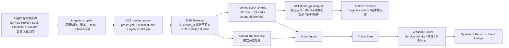

# Magpie-Horch × 50 个数字岗位分身注入方案

状态：Draft；本文件只定义方案、契约、验证门和执行 TODO。本轮没有修改
`/Users/lute/project/Magpie-Horch/` 下的任何代码、配置或生成产物，也没有导入、安装或启用任何岗位 preset。

日期：2026-09-17  
适用决定：D-021、D-022、D-023、D-024、D-025、D-026、D-027、D-028、D-029、D-053  
相关材料：[50 岗位目录](../05-agents/role-catalog.json)、[Soul Contracts](../05-agents/roles/souls/README.md)、[Role Playbooks](../06-playbooks/role-playbooks/index.json)、[Preset Blueprints](../10-platform/deepseek-harness/preset-blueprints/manifest.json)、[RP-M1 schema 与适配证据](../10-platform/deepseek-harness/MAGPIE-RP-M1-SCHEMA-EVIDENCE.md)、[RP-M2 compiler 注入规格](MAGPIE-RP-M2-COMPILER-INJECTION-SPEC.md)、[角色注入 TODO](ROLE-PRESET-IMPLEMENTATION-TODO.md)

## 1. 目标、边界与验收口径

### 1.1 目标

把 AI 组织变革项目已经确定的 50 个逻辑岗位，编译成 Magpie-Horch 可以审计、重建和挂载的 50 个独立 preset。每个 preset 必须同时具备：

1. 唯一的 `AGT-NNN` 角色身份和唯一的 `agt-nnn` preset 身份；
2. Soul Contract 中的身份、灵魂原则、停止信号和不可越权边界；
3. Role Playbook 中的独立任务入口、步骤、产物、协同、异常和验收方法；
4. Preset Blueprint 中的运行模式、提示词层、Skills、工具类别、Access 和 Assurance 契约；
5. 可被单独寻址、单独评估、单独回放和单独回滚的 Role Release Bundle 引用；
6. 只能提出 `Action Intent`，由模型外 `Policy Gate` 和 `Execution Broker` 决定并执行资产动作；
7. 在复杂 Case 中作为一个固定 Lead 或 Worker，使用已验收 `ArtifactEnvelope` 交接，不通过隐式会话或自由聊天协作。

### 1.2 本轮边界

- 只做 Magpie-Horch 的深度研究、注入设计、冲突识别和执行 TODO。
- 允许在 AI 组织变革项目中新增方案文档；不改变 Magpie-Horch 工作树。
- 不创建或安装 Shopify App，不连接企业系统，不交换凭据，不写入任何业务资产。
- 不把当前生成的本地 `~/.dsh/.agent-presets/` 输出当成生产配置或运行证据。
- 不宣称 50 个岗位已经进入 Draft、Shadow、Limited 或 Production；当前仍是设计资产。

### 1.3 完成定义

本方案只有在下列证据全部具备后，才允许进入 Magpie-Horch 实施：

| 证据 | 验收含义 |
| --- | --- |
| 源材料快照 | 50 个角色的卡片、Soul、Role Playbook、Preset Blueprint、图谱和治理契约都由唯一源文件提供，并带版本与 SHA-256 |
| Preset 完整性 | 50 个 `agt-nnn` 目录各有官方 `preset.yml`、`manifest.json`、`agent.cordis.yml`，且每个文件的角色绑定唯一 |
| 能力一致性 | persona、按需 Skills、工具可见面、Action Intent 边界和 Assurance 与该角色五份契约一致 |
| 连接一致性 | 每个 Case 只有一个 Lead；Worker 只能消费已验收 Stage Artifact；无 LLM 路由、无隐式 peer chat、无递归转授权 |
| 运行证据 | 先在隔离环境完成静态、回放、影子和有限实操门禁，再讨论任何生产权限；每一层证据单独记录 |

## 2. Magpie-Horch 只读审计结论

以下结论来自 `/Users/lute/project/Magpie-Horch/` 的固定 HEAD、当前工作树和本机已生成 preset 的只读检查。Magpie-Horch 工作树本来就存在大量未提交变更，本轮不接管、不清理、不覆盖。

### 2.1 已有能力

| 能力 | 当前实现 | 对本项目的价值 |
| --- | --- | --- |
| 50 个 preset 编译 | `scripts/role-presets/generate.mjs` 从 AI 组织材料生成 `agt-001` 至 `agt-050` | 可继续作为构建期 compiler，不必把 Magpie 变成第二份岗位事实库 |
| 三文件输出 | `preset.yml`、`manifest.json`、`agent.cordis.yml` | 有明确的官方元数据、材料快照和 Cordis 组合边界 |
| 材料保真校验 | `verify-lossless.mjs` 目前有 L1–L10 断言 | 可扩展为 Soul、Role Playbook、Blueprint、Access、Case 连接门禁 |
| 角色技能白名单 | `dsh-skill-subset` 与 `skill-map.json` | 可承载岗位 Skill 子集，但必须补齐新 Playbook 与工具可见面的契约校验 |
| 头像、排序与组织视图 | icon manifest、四平面与责任域排序写入 `x_lute` | 可保留作为展示和检索元数据，不应被解释为权限或行政汇报关系 |
| 删除/恢复保护 | preset 引用面扫描、归档、恢复和事务化删除脚本 | 注入前后必须继续保护已有会话对 preset 的不可变引用 |
| team-gui 运行面 | durable Agent/Squad、串行/并行、DAG、质量门、后台运行、用量归因 | 可作为低层执行、观测和 UI 组件，但不能直接承担本项目的 Case Control |
| 成员级工具范围 | `AgentRecord.toolScope` 支持 allow/deny | 可成为 Access Contract 的投影点，但还不能证明服务端动作边界已经闭合 |

### 2.2 已发现的缺口和冲突

| 维度 | 当前事实 | 与 50 岗位规则的冲突 | 影响 |
| --- | --- | --- | --- |
| 材料覆盖 | generator 的 `SOURCE_FILES` 只读岗位卡、role-catalog、组织图、管理图、生命周期、协作图、流程、共享 Playbooks、ROSTER 九类来源 | 没有读取 50 份 Soul、50 份 Role Playbook 和 50 份 Preset Blueprint | 新资产不会进入 manifest、persona 或 source hash；重新生成仍会丢失本项目最新契约 |
| 时间与版本 | generator 使用固定 `SNAPSHOT_DATE='2026-09-11'`、`SOURCE_DSH_VERSION='2.0.5'` | 当前 AI 组织材料已更新至 D-053/v2.3；固定快照会把过期材料看成当前事实 | 生成结果与源材料不一致，无法作为可审计的 Role Release Bundle |
| 当前产物新鲜度 | 初次只读基线曾因源材料更新出现 119 条失败；随后一次误执行的生成器运行重建了 `~/.dsh/.agent-presets/`，再次运行旧版 `verify-lossless` 已显示 L1–L10 全部通过、旧 9 类 source hash 一致 | 这只能证明旧 9 类材料已经按当前源重建，不能证明 Soul、逐岗位 Role Playbook、Blueprint 已进入产物 | 仍须扩展源集合和验证器；不得把旧版全绿当成 D-053 注入完成 |
| persona 注入 | `renderPersona` 把岗位卡全文写入 persona，并追加技能供给实况 | 新 Soul 的停止信号和灵魂原则没有进入 persona；完整 Role Playbook 也没有独立按需加载入口 | 角色可能知道旧岗位卡，却不知道新版人格、停止条件和独立 Playbook |
| 工具面 | 50 个组合都以 shipped `standard` 为基座，静态行集中包含 bash、PowerShell、filesystem、jobs、skill、goal、planning、delegation、workflow、ralph、ask-user、todo、web 等宽能力 | D-029/D-053 要求按 Access Contract 最小暴露，模型不能直接操作资产，也不能用隐式岗位互聊或 LLM 路由 | “技能白名单”不等于“工具和资产权限已经最小化”；shell、delegation、workflow 等可能绕过业务边界 |
| 协同语义 | `x_lute.squad` 是静态候选/主岗位/流程贡献元数据 | 它没有 Case、Stage Acceptance、ArtifactEnvelope、correlation_id、Action Intent 或外部 Policy Gate 的运行状态 | 不能把静态 `collaborates_with` 当作运行时消息总线或授权关系 |
| team-gui 规划 | Squad 支持 `leaderAgentId`、`activationMode`、`memberSelectionMode=adaptive`、planning context、planner token、model-tool dispatch | D-053 禁止 LLM 多 Agent 路由；Case Control 必须在模型外确定 Lead、Worker、阶段和输入产物 | 直接启用动态 planner 会重新引入被取消的路由和隐式选择语义 |
| team-gui 规模 | `SquadRecord.members` 当前最多 32 个成员 | 50 是岗位类型总数，不要求一个 Case 同时运行 50 个角色 | 不能创建“50 人固定大队”代替角色注册表；每张 Case 只能绑定一个有限子集，超过上限应拆成关联 Case |
| preset 身份绑定 | `AgentRecord` 主要有 name、systemPrompt、provider、model、toolScope 等字段，没有不可变 `presetId`/Role Release Bundle ref | 仅复制 systemPrompt 不能证明子会话运行的是命名 preset | 必须增加模型外的 preset resolver/adapter 或验证过的宿主映射，不能用名称约定冒充绑定 |
| 产物交接 | team-gui 有 handoff summary、任务记录和运行历史，但 Magpie 源码没有本项目定义的 `ArtifactEnvelope` 与 Stage Acceptance 实现 | D-024/D-025/D-053 要求只交接已验收产物并保留来源、版本、hash 和接收记录 | 需要在 Case Control/adapter 层补齐产物协议，不能把 handoff 文本直接当验收产物 |
| 外部产品边界 | `PRODUCT_MOUNTS` 为空，且 AGENTS 要求外部产品走 profile 本地装配，不烘焙进出货 preset | 把业务连接器或店铺产品包直接写入 50 个出货 preset 会引入机器路径和硬依赖 | 业务连接器必须由外部 Broker/profile 装配，preset 只声明类别和契约引用 |

### 2.3 当前结论

Magpie-Horch 适合承担“同源编译器 + preset 静态校验 + DSH 运行面适配”的角色，不适合直接充当 50 岗位的业务控制平面。当前 50 个派生目录在旧版 L1–L10 校验下已经可重建，但它们仍只覆盖旧 9 类材料，因此“生成成功”不等于 D-053 注入完成。当前最重要的工作不是向 50 个目录逐个复制 prompt，而是先把以下四个边界固定下来：

1. **材料边界**：AI 组织变革项目是 Soul、Role Playbook、Blueprint、图谱和经营规则的唯一事实源；Magpie 只编译和验证。
2. **运行边界**：一个角色 preset 可以独立工作；复杂 Case 由模型外 Case Control 选择一个 Lead 和有限 Worker 集合。
3. **资产边界**：模型输出 Action Intent；Policy Gate 和 Execution Broker 持有 Service Identity 并执行受控副作用。
4. **证据边界**：静态生成成功、DSH mount 成功、影子运行成功、业务有限实操和生产验收是五层不同证据，不能互相替代。

## 3. 目标注入架构

### 3.1 四层组件图



### 3.2 角色资产的唯一事实和生成归属

| 资产 | 唯一事实源 | Magpie 生成/验证职责 | 不允许的做法 |
| --- | --- | --- | --- |
| Role Profile | `docs/05-agents/roles/AGT-NNN.md`、`role-catalog.json` | 逐字快照、角色 ID 一致性、图谱引用校验 | 在 Magpie 另写一份岗位定义 |
| Soul Contract | `docs/05-agents/roles/souls/AGT-NNN.soul.md` | 快照、hash、人格/灵魂/停止信号完整性校验 | 把人格描述当成权限或预算 |
| Role Playbook | `docs/06-playbooks/role-playbooks/AGT-NNN.md` | 快照、技能段落解析、独立入口/产物/异常/验收检查 | 把共享 PB 当成岗位专属 Playbook 的替代品 |
| Preset Blueprint | `docs/10-platform/deepseek-harness/preset-blueprints/AGT-NNN.json` | schema 校验、角色引用一致性、目标 DSH 版本证据检查 | 未核实 schema 就生成可导入配置 |
| 组织和协作图 | `organization-graph.json`、`agent-management-graph.json`、`agent-lifecycle.json`、`collaboration-graph.json` | 角色边、平面、生命周期、Lead/Worker 候选和流程范围的来源快照 | 把 `collaborates_with` 变成自由消息或权限授予 |
| 运行状态 | Case/Event Ledger 与外部 DSH 运行记录 | 记录 preset/bundle ref、Case、stage、artifact、receipt 的证据 | 将生成时间、UI 显示或模型回答当作运行事实 |

生成输出继续落在 `~/.dsh/.agent-presets/`，不提交到 Magpie 仓库。可复现性由“源材料 revision + generator revision + 规则 + 依赖版本 + 输出 hash”保证；如果以后需要可携带发布包，应另建明确的 release artifact，而不是把同一事实复制回源码。

### 3.3 每个 preset 的建议结构

以下是目标结构，不是当前 DSH 可直接导入的 schema。必须在 P1/P2 阶段读取目标 DSH 官方类型和本机行为后再固化字段名称。

```yaml
preset_id: agt-001
role_id: AGT-001
role_release_bundle: RRB-AGT-001-<immutable-version>
status: blueprint_only_not_importable
material:
  role_profile: { path: ..., sha256: ... }
  soul_contract: { path: ..., sha256: ... }
  role_playbook: { path: ..., sha256: ... }
  preset_blueprint: { path: ..., sha256: ... }
  graph_refs: { ... }
runtime:
  standalone_entrypoint: role_task
  composition_entrypoint: bounded_role_worker
  orchestration_owner: external_case_control
  peer_chat: false
  re_delegation: false
access:
  default_decision: deny
  visible_tool_classes: [fact_read, deterministic_validate, artifact_emit, action_intent_request, receipt_query]
  service_identity_holder: execution_broker_outside_model
assurance:
  eval_suite_ref: EVAL-AGT-001
  production_authorized: false
```

`preset.yml` 仍只承载官方需要的展示元数据；`manifest.json` 承载材料快照和 `x_lute` 平台扩展；`agent.cordis.yml` 承载经过验证的运行组合。不能把 Blueprint 原始 JSON 直接当作 DSH 导入文件。

## 4. Soul、Role Playbook 与 Prompt/Skill 分层

### 4.1 推荐方案：人格摘要常驻，完整 Playbook 按需读取

建议采用“C：摘要 + 按需正文”的组合方式：

- persona 常驻：角色身份、使命、灵魂原则的可检验表现、绝不做什么、停止信号、Action Intent 和 ArtifactEnvelope 的硬边界；
- role-specific Skill：完整 Role Playbook、技能步骤、输入输出 schema、异常和验收清单，按任务需要加载；
- workspace 稳定层：业务词汇、Role Release Bundle ref、环境和版本；
- Case 稳定层：Case Charter、主价值流、主场景、Access Contract、已验收 Artifact 索引；
- 回合动态层：最新信号、工具回执、当前 attempt 和冻结/恢复信息。

这样既保留数字分身的“自我认识”，又遵守上下文缓存和渐进披露原则。当前 Magpie 已能把岗位卡放入 persona，但没有证据表明它已经提供了“每个岗位完整 Playbook 的按需 loader”，因此要把 loader 当作待验证能力，而不是假设存在。

### 4.2 兼容回退

如果 P1 验证发现目标 DSH 版本不能按 preset scope 加载 role-specific Skill，则只能在明确的体积、缓存和安全评估后选择下列回退：

1. 将 Role Playbook 以受控字面块放入 persona，并在 manifest 中保留完整原文和 hash；或
2. 把 Playbook 正文作为一个只读本地 skill 资源挂载，再由 `dsh-skill-subset` 逐岗位白名单选择；
3. 不得用一段“请参考某路径”的提示替代正文，除非 loader 的存在、路径解析、版本绑定和失败冻结都有测试证据。

## 5. 工具、权限和执行边界

### 5.1 目标最小工具面

所有业务岗位默认只允许以下能力类别，具体工具名和 schema 待目标 DSH 版本、插件版本及企业系统契约核实：

| 类别 | 用途 | 结果 |
| --- | --- | --- |
| `fact_read` | 读取允许范围内的权威事实或聚合数据 | 带来源、时间窗、schema 和质量状态的事实片段 |
| `deterministic_validate` | 运行口径、范围、去重、策略和幂等检查 | 结构化通过/冻结/拒绝结果 |
| `artifact_emit` | 生成岗位产物或 Stage Artifact 草稿 | 只能提交验收，不代表已验收 |
| `presentation` | 请求 UI 卡片、表格、图谱或待办展示 | 只表达展示意图，服务端补权威事实 |
| `action_intent_request` | 提出受结构约束的 Action Intent | 不能直接调用资产写接口 |
| `receipt_query` | 查询 Policy Gate、Broker 和 system-of-record 回执 | 未核实回执不得声称成功 |

下列能力不能默认对业务岗位可见：任意 shell/PowerShell、任意 filesystem 写入、任意 web 抓取、任意 jobs 调度、任意 workflow 执行、`dispatch_to_squad`、递归 subagent、凭据读取和直接平台写接口。平台/Agent 工程岗位如需额外读取能力，必须在其 Access Contract 中单独声明并做负向测试；额外读取不自动授予资产写入。

### 5.2 现有 standard 组合的处理原则

不能直接在现有 50 个组合上逐行手删或手改。实施时由 compiler 根据经过确认的 Access Contract 生成角色专属组合，并为每个角色输出：

- 允许工具类别及实际工具名的解析结果；
- 被拒绝的工具和拒绝原因；
- `Action Intent only`、凭据不可见、Service Identity 在 Broker 外部的断言；
- 对 delegation、workflow、web、shell、filesystem 和直接资产写工具的负向测试结果。

若目标 DSH 只支持全局 standard 行集，则必须在宿主/插件层实现服务端 allowlist 和 broker 隔离；“在 system prompt 里说不能用”不算权限控制。

## 6. 独立模式与复杂 Case 组队

### 6.1 独立模式

独立模式用于边界清晰的岗位任务：

1. 外部入口提交任务合同，包含目标、业务对象、范围、时间窗、输入版本和验收者；
2. Resolver 解析唯一 `preset_id` 和不可变 Role Release Bundle；
3. 角色按 Soul + Role Playbook + 允许 Skills 工作；
4. 角色产出岗位主产物、`Action Intent`、`NO_ACTION` 或 `HOLD`；
5. 外部验收记录产物状态，必要时交给后续 Stage 或新 Case；
6. 任何外部副作用必须经 Policy Gate → Execution Broker → 权威回执。

### 6.2 复杂 Case 模式

复杂 Case 使用 D-053 的固定语义：

- 一张 Case 只有一个主价值流、一个主场景、一个 Lead 和一个结果责任；
- Case Control 在模型外根据版本化规则选出 Lead 和有限 Worker 集合；
- Worker 只接收已验收的 `ArtifactEnvelope` 和本岗位任务合同；
- Worker 返回带 schema、来源 Case、Stage、Hash、范围和验收状态的增量产物；
- Lead 负责整合，但不能把 Worker 结果直接变成已验收或已执行事实；
- 岗位之间没有隐式共享会话、自由 peer chat 或再委派；
- 跨价值流信号拆成共享 `correlation_id` 的独立 Case，各自拥有状态、Bundle、资源预留和关闭结果；
- FLOW-07 的 Emergency Guard 留在模型外，仅能在确定性规则命中且唯一绑定成立时生成最小保护 Intent，不授予任何岗位直接写权限。

### 6.3 team-gui 的定位

推荐把 `dsh-agent-team-gui` 定位为“执行和观测适配层”，而不是业务编排大脑：

| team-gui 能力 | 目标使用方式 | 必须关闭/限制 |
| --- | --- | --- |
| AgentRecord | 保存一个运行成员的 provider/model、只读 systemPrompt 摘要和工具范围 | 增加或由 adapter 维护不可变 preset/bundle 绑定；不能只靠 name |
| SquadRecord | 表达一张 Case 的固定 Lead + 有限 Worker 子集 | 不创建覆盖 50 岗位的固定大队；成员数遵守 32 上限 |
| 固定串行/有限并行 | 执行 Case Control 已给出的阶段顺序 | 禁止由模型重新选择成员和顺序 |
| Run history / usage | 记录运行、阶段、成员、成本和失败 | 以 Case/Event Ledger 的验收记录为权威，不以 UI 历史替代 |
| Quality gate | 执行有限复核/修复回合 | 复核角色和回合数必须由契约预声明；不得变成无限 planner recursion |
| `dispatch_to_squad` | 未来由模型外 adapter/host service 调用 | 不向岗位模型暴露为自由路由工具，不接受任意成员和任意任务参数 |
| dynamic planner / adaptive selection | 仅保留用于非业务实验环境 | 业务 Case 中关闭；若插件无法关闭，不能作为本项目生产编排器 |

如果一个业务场景的候选角色超过 32，不能把 50 个角色塞进一个 Squad；应按价值流和 Stage 拆成多张相关 Case，并用 `correlation_id` 和已验收 Artifact 关联。

## 7. 连接图谱的注入规则

### 7.1 静态图谱和运行图谱分离

静态 `organization-graph`、`agent-management-graph`、`collaboration-graph` 进入每个 preset 的材料快照和 `x_lute` 检索元数据。它们只回答“这个岗位能为哪些流程、场景和阶段提供能力”，不直接授予运行权限。

运行时必须另建 Case 级记录：

```json
{
  "case_id": "CASE-...",
  "correlation_id": "CORR-...",
  "primary_flow": "FLOW-xx",
  "primary_scenario": "SCN-xxx",
  "lead": {
    "role_id": "AGT-NNN",
    "preset_id": "agt-nnn",
    "role_release_bundle": "RRB-..."
  },
  "workers": [
    {"role_id": "AGT-NNN", "preset_id": "agt-nnn", "input_artifact_ids": ["ART-..."]}
  ],
  "stage_attempts": [],
  "artifact_acceptances": [],
  "action_intents": [],
  "policy_decisions": [],
  "execution_receipts": []
}
```

这里的 JSON 只是概念契约示例，不能在未确认 schema 前直接部署。每个 Stage Attempt、Acceptance Record、Action Intent 和 Receipt 都要有独立 ID、版本、hash、时间、状态和来源关系。

### 7.2 连接边的四种合法含义

1. `primary_eligibility`：该角色可以在某类规则下担任 Lead 候选；不等于本次 Case 已被选中。
2. `worker_contribution`：该角色可以在指定 Stage 贡献某类产物；不等于可以读取所有上下文。
3. `artifact_handoff`：某个已验收 Artifact 可作为下游输入；必须绑定来源 Case、版本、Hash 和接收 Acceptance。
4. `correlation_reference`：跨价值流 Case 的关联信号；不共享状态、权限、资源预留或关闭结果。

`collaborates_with`、`eligible_flows` 和历史 candidate contributor 边不得被解释为“可以互相调用”“可以互相转授权限”或“可以自由对话”。

## 8. 分阶段执行 TODO 与门禁

### RP-M0：事实冻结与边界确认（本轮已完成只读审计）

- [x] 固定 Magpie-Horch branch、HEAD、当前工作树状态；确认不接管已有 dirty changes。
- [x] 确认 50 个生成目录、三文件结构、标准组合行集和技能子集现状。
- [x] 运行只读 `verify-lossless`，记录初次源漂移造成的 119 条失败；随后误执行生成器后复跑，旧版 L1–L10 已通过。该结果只覆盖旧 9 类材料。
- [x] 对比 AI 组织项目当前源 hash 与生成 manifest，确认 Soul/Role Playbook/Blueprint 尚未进入生成快照。
- [x] 检查 team-gui 的 Agent/Squad schema、成员上限、planner 和 toolScope 能力。
- [ ] 将本方案中的开放决策转为用户确认的 D 编号。

**门禁 RP-G0：** 有证据的事实、候选设计、用户决定和未验证假设分栏；Magpie 代码零修改。

### RP-M1：目标 DSH 与材料契约定版

- [x] 记录当前 Magpie pin、本机 DSH 产品身份、运行版本、宿主版本、插件版本、preset 官方 schema 和验证路径；目标企业部署仍保留为 Unknown。
- [x] 从源码核实 `dsh-skill-subset` 的 preset scope 白名单、`hideOthers`、`source` 和 Playbook `SKILL.md` 读取边界；目标 Host 的运行 loader 仍待验证，并已记录受控回退。
- [x] 提出 `role_assets`、`source_hashes`、`role_release_bundle_ref` 的 manifest schema，并明确其为 Magpie 扩展候选而非 DSH 官方字段。
- [x] 提出 `ActionIntent`、`ArtifactEnvelope`、`StageAcceptanceRecord`、`Case` 的外部 adapter schema，并明确不伪装成当前 DSH 原生字段。
- [x] 提出角色级工具 allowlist 的类别、命名、拒绝方式和服务端强制点；实际宿主拒绝行为仍待 RP-M3/RP-M5 验证。

RP-M1 的证据、字段草案、Observed/Proposed/Unknown 分栏和 DSH 原生能力映射见[RP-M1 schema 与适配证据](../10-platform/deepseek-harness/MAGPIE-RP-M1-SCHEMA-EVIDENCE.md)。以上勾选表示设计与源码核验已完成，不表示 RP-G1 已通过或任何配置已获准导入。

**门禁 RP-G1：** 所有影响 schema、提示词分层、权限、运行模式和兼容性的决定都有批准记录；未核实的 DSH 键不进入实施 patch。

### RP-M2：同源 compiler 注入（已完成材料注入，Host 适配后置）

实施规格见[RP-M2 compiler 注入规格](MAGPIE-RP-M2-COMPILER-INJECTION-SPEC.md)。本轮已获用户授权并完成 Magpie-Horch 的材料注入、静态校验和实际派生 preset 重建；目标 Host 的岗位 Skill loader、导入 schema、工具边界和生产连接仍后置验证。

- [x] 扩展 `SOURCE_FILES`，读取 50 个 Soul、50 个 Role Playbook、50 个 Blueprint 及其 index/manifest。
- [x] 为每个角色计算原始字节 hash、源 revision、generator revision 和依赖版本，并写入 `source_snapshot`。
- [x] 将新资产以独立 `manifest.role_assets` 命名空间写入；与旧 `material` / `x_lute` 平台元数据分离。
- [x] 将 Soul 的身份、灵魂原则、停止信号和资产边界注入 persona 的固定摘要；完整岗位卡仅归档在 manifest。
- [x] 将完整 Role Playbook 写入岗位专属可寻址 Skill descriptor 与逐字快照；loader 未核实前明确 `target-host-to-be-verified`，不冒充已加载。
- [x] 将 Blueprint 的 modes、prompt layers、visible tool classes、access、assurance 和 DSH projection 作为闭合 record 写入并校验。
- [x] 将源 revision 与 generator revision 写入快照，保留兼容用的 `snapshot_date`。
- [x] 保持 `PRODUCT_MOUNTS={}` 与外部产品不进出货 preset 的规则。
- [ ] 目标 Host 的岗位 Skill `SKILL.md` 派生、schema 导入、真实 mount 与批量 I/O 原子替换：进入 RP-M3/RP-M4 隔离适配。

**门禁 RP-G2：** 50/50 角色资产存在、ID 唯一、引用闭合、hash 可重建；生成器可重复运行且不手改产物；旧会话引用保护测试继续通过。当前材料注入门已通过，Host loader/mount 与生产授权仍未通过。

### RP-M3：角色级组合和 Access 投影

- [ ] 为 50 个角色生成可解释的工具可见矩阵；默认拒绝未声明工具。
- [ ] 移除或服务端拦截业务岗位的任意 shell、filesystem 写、web、workflow、jobs、delegation 和直接资产写工具。
- [ ] 为需要工程读取能力的 Agent 平台岗位单独建立例外契约和负向测试。
- [ ] 确保模型只能产生结构化 Action Intent；Policy Gate、Execution Broker、凭据和 Service Identity 不在模型可见面。
- [ ] 为 standalone 与 bounded worker 生成不同的运行标识和任务合同校验。

**门禁 RP-G3：** 每个岗位的实际工具集合与 Access Contract 完全一致；越权动作、凭据读取、直接资产写、递归委派和自由 dispatch 均被阻止并留下审计记录。

### RP-M4：preset resolver 与 Case Control adapter

- [ ] 定义从 `preset_id` 到不可变 Role Release Bundle 的 resolver；禁止只按名称或 systemPrompt 绑定。
- [ ] 将 Case Control 的 Lead、Worker、Stage、Artifact、Acceptance 和 correlation_id 传给 adapter。
- [ ] 使用 team-gui 的固定成员和执行能力承载运行观测；业务 Case 关闭动态 planner、adaptive member selection 和模型驱动路由。
- [ ] 禁止 Worker 再调用 squad、workflow、subagent 或其他岗位转授权限。
- [ ] 把 handoff summary 转换为带 hash 和验收记录的 ArtifactEnvelope；未验收产物不可进入下游。
- [ ] 将运行结果、Policy Decision、Broker receipt 和异常冻结写入外部 Case/Event Ledger。

**门禁 RP-G4：** 回放一张正常多阶段 Case、一张缺失输入 Case、一张跨流相关 Case；都能证明一个 Lead、有限 Worker、固定阶段、Artifact 验收和无隐式 peer chat。

### RP-M5：静态与动态验证扩展

- [ ] 将 `verify-lossless` 从 L1–L10 扩展为 Soul、Role Playbook、Blueprint、工具范围、Case 连接和生命周期断言。
- [ ] 新增 50 个角色的正向测试：独立任务入口、产物、Skill 引用、灵魂原则和停止信号。
- [ ] 新增负向测试：缺证据、过期输入、冲突口径、跨范围请求、凭据诱导、直接写资产、伪造回执、跳过 Acceptance、自由 peer chat、递归委派。
- [ ] 新增连接测试：Lead 数量只能为 1；Worker 必须引用已验收 Artifact；主流和主场景只能各 1 个；跨流只共享 correlation_id。
- [ ] 新增生成稳定性、源 hash 漂移、旧会话 preset 引用、icon、`PRODUCT_MOUNTS` 和 profile 依赖测试。
- [ ] 在 Magpie 工作树中运行 `pnpm run gate`；只有代码变更稳定后才运行 `pnpm run gate:full`。

**门禁 RP-G5：** 静态 gate、类型/单测、构建、隔离 mount 和回放全部通过；失败原因和未覆盖项有记录，不能用总绿灯掩盖分项缺口。

### RP-M6：四角色影子试运行

建议先选择四类代表岗位，而不是同时启用 50 个运行实例：

- 经营管理：AGT-001；
- 业务运营：从首个 Shopify DTC 场景中选择一个主岗位；
- 独立控制：AGT-005 或对应的独立复核岗位；
- 数据与 Agent 平台：选择一个平台治理岗位。

- [ ] 每类至少回放正常、缺失、冲突、工具失败、部分成功、回执不明和重启七类样例。
- [ ] 比较独立模式与固定 Lead/Worker 模式的闭环成功率、SLA、冻结率、单位任务成本和人工复核负荷。
- [ ] 只允许脱敏 fixture 或已授权只读数据；不创建订单、商品、广告、库存、退款或店铺写动作。
- [ ] 形成是否扩大到其余 46 个岗位的准入记录。

**门禁 RP-G6：** 四角色在影子环境通过所有安全和产物门，且没有凭据、直接资产写、伪造回执或动态路由证据；不等于生产授权。

### RP-M7：逐岗位扩展和版本生命周期

- [ ] 以同一 compiler 生成 50 个最新 preset，不逐个手改。
- [ ] 每个岗位建立 Role Release Bundle 版本和七状态生命周期记录。
- [ ] 每次源材料或运行规则变化都生成新 bundle；现有 Case 固定旧 bundle，不原地替换。
- [ ] 退化、策略撤回、hash 漂移、工具行为变化和外部回执不明时进入 Quarantined/Frozen。
- [ ] 生产前另行取得业务、数据、权限和发布授权；本方案不自动扩大授权。

**门禁 RP-G7：** 50 个岗位均可独立寻址、回放、评估和回滚；每次运行有可验证的 bundle、Case、Stage、Artifact、Policy 和 Receipt 证据。

## 9. 需要您逐项确认的关键决策

这些问题会直接改变 prompt 体积、DSH 组合 schema、运行权限和 team-gui 适配方式，不能由实现阶段猜测。建议先按推荐项确认。

### Q1：完整 Role Playbook 在运行时如何提供？（已确认：C）

用户已确认采用“摘要常驻 + 正文按需 Skill 加载 + 受控内嵌回退”。以下选项保留为决策记录：

- **A：全部内嵌 persona**：实施最简单，但静态上下文和缓存成本最大。
- **B：全部作为按需 Skill**：最符合渐进披露，但依赖目标 DSH 的 role-specific loader 能力。
- **C：推荐——persona 放身份/灵魂/停止信号摘要，完整 Playbook 作为按需 Skill；loader 不可用时走受控内嵌回退**：兼顾独立自我认识、上下文控制和兼容性。

### Q2：是否把 50 个业务岗位从 shipped standard 的宽工具面收缩为最小 Access allowlist？（已确认：B）

用户已确认所有岗位默认最小权限，平台岗位的额外读取能力逐项例外，所有写动作只输出 Action Intent。以下选项保留为决策记录：

- **A：保留 standard，只在提示词中约束**：改动少，但不满足服务端权限边界，不建议。
- **B：推荐——所有岗位默认最小 allowlist，平台岗位的额外读取能力逐项例外；所有写动作都转为 Action Intent**：与 D-029/D-053 一致。
- **C：仅先限制业务岗位，平台岗位暂保留 standard**：可作为短期实验，但会留下平台角色越权和递归路由风险。

### Q3：team-gui 在复杂 Case 中承担什么角色？（已确认：B）

用户已确认外部 Case Control 负责业务编排，team-gui 只作为固定执行、UI、运行历史和用量观测适配层。以下选项保留为决策记录：

- **A：让 team-gui 的 dynamic planner 直接编排岗位**：实现快，但违反“模型外 Case Control”和无 LLM 路由规则。
- **B：推荐——外部 Case Control 负责 Lead/Worker/Stage/Artifact，team-gui 只负责固定执行、UI、运行历史和用量观测**：保留已有产品价值，同时不改变控制平面。
- **C：完全不用 team-gui，另建执行面**：边界最清楚，但重复建设运行和观测能力。

### Q4：子会话如何绑定命名 preset？（已确认：B）

用户已确认采用模型外 preset resolver/adapter，将 `preset_id + immutable Role Release Bundle` 解析为子会话组合。以下选项保留为决策记录：

- **A：仅把 role prompt 写入 `systemPrompt`**：无法证明使用了哪个 preset/bundle，不建议。
- **B：推荐——增加模型外 preset resolver/adapter，把 `preset_id + immutable Role Release Bundle` 解析成子会话组合；AgentRecord 只保存不可变引用或其快照**：可审计、可回滚。
- **C：先用约定的 AgentRecord name 映射，后续再补 resolver**：适合短期 spike，但不能作为 Case 或生产依据。

### Q5：生成的 150 个文件是否提交到 Magpie 仓库？（已确认：B）

用户已确认生成目录继续作为 `~/.dsh/.agent-presets/` 派生输出，仓库只保存 compiler、规则、schema、验证器和来源引用。以下选项保留为决策记录：

- **A：提交生成目录**：查阅方便，但制造第二事实源并违反 Magpie 现有规则。
- **B：推荐——继续只提交 compiler、规则、schema 和验证器，生成输出留在 `~/.dsh/.agent-presets/`；发布时按源 revision 重建**：保持同源和可复现。
- **C：另建经过签名的 release artifact 仓库**：适合未来跨机器发布，但必须单独设计 provenance 和生命周期，不能直接复制进当前仓库。

### Q6：50 个岗位是否一次性进入运行验证？（已确认：B）

用户已确认 compiler 一次覆盖 50 个岗位，运行验证先做 4 个代表岗位影子试验，再按门禁扩展。以下选项保留为决策记录：

- **A：一次性启用 50 个**：覆盖快，但难以区分角色、工具和连接问题。
- **B：推荐——compiler 一次覆盖 50 个，运行验证先做四角色影子试验，再按门禁扩展**：保证最终覆盖，同时控制诊断面和风险。
- **C：只做 4 个 preset，不先支持全量 compiler**：验证快，但无法证明 50 个资产闭合。

## 10. 本轮输出与下一步

本轮已经完成：

- Magpie-Horch 的只读结构、生成器、保真校验器、team-gui schema 和当前 preset 输出盘点；
- 50 个岗位资产注入前的证据确认，以及本轮注入后的 L1–L12 回读结果；
- 与 D-053 规则冲突的材料、工具、动态路由、preset 身份和 Artifact 交接问题分类；
- 同源编译、最小权限、外部 Case Control、resolver/adapter 和分阶段门禁方案；
- RP-M0 至 RP-M7 的可执行 TODO 和验收标准；
- 六个需要用户明确取舍的关键问题。
- RP-M1 的只读 schema 与 adapter 证据，见[DSH预设与适配契约证据](../10-platform/deepseek-harness/MAGPIE-RP-M1-SCHEMA-EVIDENCE.md)；其中官方能力、外部候选契约和未验证项已分栏。
- RP-M2 的 compiler 注入规格与实施结果，见[RP-M2 compiler 注入规格](MAGPIE-RP-M2-COMPILER-INJECTION-SPEC.md)；Magpie-Horch 已按该规格完成 50 份角色资产注入，L1–L12 静态校验 5106 条断言通过，目标 Host 适配仍为后续门。

Q1–Q6 已确认后，RP-M1 的只读 schema 与 adapter 证据及 RP-M2 的 compiler 实施与验证已经沉淀；下一步是在隔离环境核实目标 DSH 岗位 Skill loader、preset schema、真实 mount 和角色级工具边界。若目标 DSH 类型或 team-gui 宿主行为无法证明某项能力，则停在设计/隔离 spike，不生成貌似可运行的配置，也不触碰 Magpie-Horch 生产或业务连接。

## 11. 本轮操作偏差记录

只读审计子任务误执行了一个不支持 `--help` 的生成器命令。该命令没有修改 Magpie-Horch 仓库文件，但重建了其约定的派生目录 `~/.dsh/.agent-presets/agt-001` 至 `agt-050`。当前只读复核结果为：50 个目录、每个三文件结构存在，旧版 `verify-lossless` 的 L1–L10 通过；manifest 仍没有 `role_assets`、Soul Contract、逐岗位 Role Playbook 或 Preset Blueprint 快照。

用户已确认暂时保留这次重建结果（D-054）。这只表示保留当前派生目录，不表示新三类角色资产已经注入或任何运行/生产授权已经开启。后续实施前仍必须在 RP-M1 重新固定源 revision、生成器 revision 和派生输出 hash；在没有可验证备份的情况下，不删除、不擅自回滚，也不把当前派生目录当成可审计发布物。
